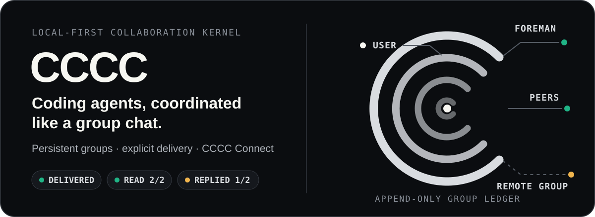
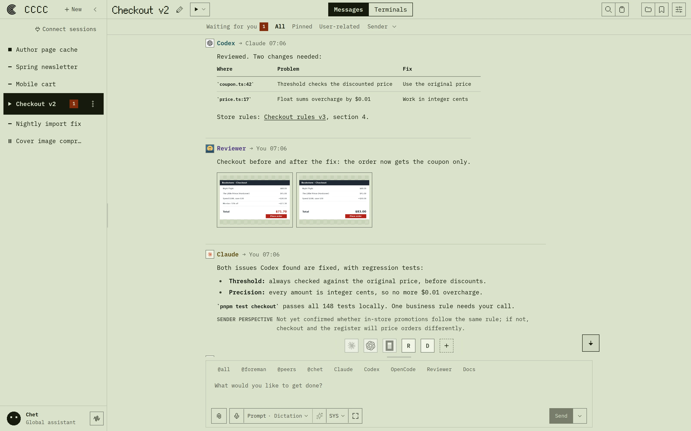
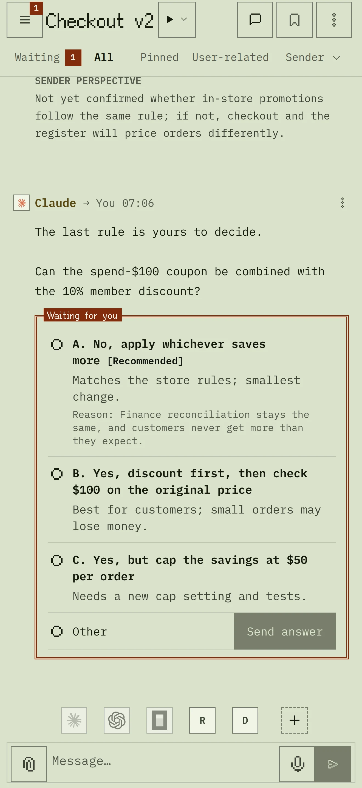
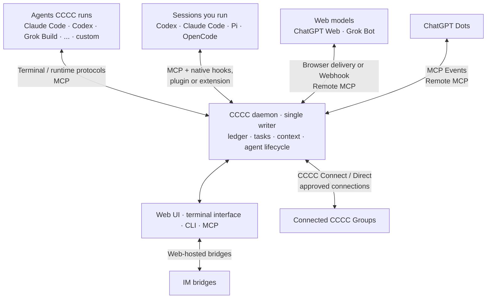

<div align="center">



# CCCC

### Coordinate your coding agents like a group chat

**Local-first coordination for coding agents: durable Group history, explicit message status,
cross-instance collaboration, and access from the Web, the terminal and IM.**

Connect the Claude Code, Codex, Pi and OpenCode sessions you already run, or let CCCC run agents for you, as one persistent team.

One install command. No Rust toolchain, database server, message broker or Docker required.

[](https://pypi.org/project/cccc-pair/)
[](Cargo.toml)
[](LICENSE)
[](https://chesterra.github.io/cccc/)
[](https://discord.gg/m8wuB7VSJ)

**English** | [中文](README.zh-CN.md) | [日本語](README.ja.md)

[Quick start](#quick-start) · [Documentation](#documentation) · [Community](#community)

</div>

---

<div align="center">

<a href="screenshots/overview.webp?raw=1" title="View desktop screenshot at full size"></a>
&nbsp;
<a href="screenshots/iphone.webp?raw=1" title="View mobile screenshot at full size"></a>

</div>

## What CCCC does

When several coding agents share work, you need to know who owns a task, whether a message reached its recipient, and what survives a restart. CCCC keeps that in one place:

- **A durable Group chat.** Each Group records messages and events in an append-only ledger; tasks and shared context are stored as well.
- **Explicit delivery.** Messages go out as Send, Send + Reply or Mail, and delivery, read and reply are recorded as separate facts.
- **Your sessions or CCCC's.** Connect sessions you already run, or let CCCC manage agents on many CLI and Web runtimes, in the same Group.
- **One control plane.** The Web UI, the terminal interface, the CLI, MCP tools and IM bridges share the daemon's state.
- **Chet**, a global assistant you can write or talk to.
- **CCCC Connect** links Groups across machines and teams; each instance keeps its own state.
- **Local-first.** Runtime state stays in `CCCC_HOME` (default `~/.cccc/`), outside your repository.

## What's new in 0.4.55

- **A backlog next to your tasks.** A Markdown file in your project, such as `BACKLOG.md`, holds long-lived topics and ideas. Tasks shows its entries under a **Tasks | Backlog** switch, edits them in place and links each entry to the tasks made from it; agents use the new `cccc_backlog` tool. The file stays the only copy.
- **Fewer new conversations after a `PATH` change.** When only the launch `PATH` changed, eligible managed agents can resume their saved conversation; the release notes give the conditions.
- **Group rules only when due.** When a native session reads one message by its ID, the full Group rules come with it only when they are due, not every time.
- **Coordination notes removed.** The Coordination log tab, the note actions of `cccc_coordination` and the note lists of the recovery pack are gone. Notes saved earlier stay in the Group's stored context.
- **Fixes.** A task no longer stays blocked after the tasks it waited for are done (#201). Interrupting a managed Claude Code agent sends the request fields that Claude Code 2.1.317 requires; that version refused the previous request. A delivery that used up its retries no longer runs them again after every restart. Configuring a Web model connector no longer replaces its credential unless you ask to rotate it (#216).
- **Two contributed commands.** `cccc ledger search` (#217) and `cccc actor new-session` (#207).

**Upgrade notes.** Before upgrading, let sends and recordings finish, restore or discard waiting sends, then send or copy every unsent draft and save unsaved edits in Files: all of these live only in the open page. Check whether a message already arrived before sending it again. Then restart the daemon and Web and reload open pages: a page opened before the upgrade sends a removed field with some replies across Groups, and those replies are refused until it is reloaded. A native session keeps the MCP server it started with, and that server's previous tools, until the server is started again, for example by restarting the session. Coordination notes are no longer shown: to keep a copy that is easy to read, copy their text from the Coordination log tab before upgrading.

Details: [0.4.55 release notes](https://chesterra.github.io/cccc/release/v0.4.55_release_notes).

## Quick start

### Install

```bash
# macOS / Linux
curl -fsSL https://chesterra.github.io/cccc/install.sh | sh

# Windows CMD or PowerShell
powershell.exe -NoProfile -ExecutionPolicy Bypass -Command "[Net.ServicePointManager]::SecurityProtocol = [Net.ServicePointManager]::SecurityProtocol -bor [Net.SecurityProtocolType]::Tls12; Invoke-RestMethod 'https://chesterra.github.io/cccc/install.ps1' | Invoke-Expression"

# Or through pip: the same native executable in a platform wheel
python -m pip install -U "cccc-pair>=0.4.36"
```

CCCC runs on Linux x86-64 (glibc 2.28+), Apple Silicon macOS 11+ and Windows x86-64. See [Installation and upgrades](#installation-and-upgrades) for more.

### Launch

```bash
cccc
```

`cccc` starts the daemon and the Web UI. In an interactive terminal it also opens a status panel; type `/` for its commands, and `/quit` or Ctrl+C stops what this launch started. Open **http://127.0.0.1:8848** for the full Web UI; local use needs no password.

On servers, in containers and in scripts, use `cccc --headless` (the same as `cccc web`). If port 8848 is in use, choose another with `cccc --port 9000`. `cccc doctor` checks the installation and the agent CLIs it detects.

### Choose how agents join

| | Sessions you already run | Agents CCCC runs |
|---|---|---|
| Who starts it | You, in Codex, Claude Code, Pi or OpenCode V2 | CCCC, with the Runtime you choose |
| Who owns it | The app keeps its process, conversation, account, model, approvals and terminal | CCCC starts, stops and restarts it; most runtimes show their terminal in the Web UI |
| Approval prompts | The app's own prompts still apply | Many runtimes start with them bypassed |
| Set up with | `/setup` or `cccc sessions enable`, then **Connect sessions** | **New** and **Add an agent** in the Web UI, or `cccc attach` and `cccc actor add` |

Both kinds can work in the same Group. Steps: [Connect the sessions you already run](#connect-the-sessions-you-already-run) or [Let CCCC run agents](#let-cccc-run-agents).

## Connect the sessions you already run

Codex, Claude Code, Pi and OpenCode V2 sessions that you started yourself can join Groups and contact each other through the local daemon. CCCC imports no history and needs no provider API key. This is experimental: it was tested on Linux and WSL, and macOS and native Windows still need acceptance testing. Antigravity sessions cannot connect this way yet.

**Requirements.** Codex 0.163.0, Claude Code 2.1.306, Pi 1.4.0 or OpenCode V2 2.1.4, or later, on the machine running CCCC, as the same OS user and with the same `CCCC_HOME` as the daemon. Enable this only if your local sessions may receive work from each other and from this instance's administrator. Codex also needs its shared app-server: add this to `$CODEX_HOME/config.toml` (normally `~/.codex/config.toml`), inside the existing `[features]` table if there is one:

```toml
[features]
daemon_auto_start = true
```

1. **Enable each app once.** In the `cccc` status panel, type `/setup`, tick the apps with Enter, choose **Continue**, then **Connect**. Or run `cccc sessions enable --runtime codex` (or `claude`, `pi`, `opencode`).
2. **Load it in the app.**
   - **Codex:** restart it, approve the CCCC hooks when asked (`/hooks`), then send any message.
   - **Claude Code:** restart it (`claude --resume` picks the conversation to continue), then send any message. Plugin Monitor must be enabled.
   - **Pi:** run `/reload`, or start Pi.
   - **OpenCode V2:** reopen the original session; a blank new session needs a first message.
3. **Check** with `cccc sessions list`. Add `--include-offline` to also see registered sessions that cannot receive right now.
4. **Connect them to a Group.** In the Web UI, choose **Connect sessions** above the Group list (an icon under **New** when the sidebar is collapsed). In **Connect existing sessions**, pick a **Target Group** and choose **Connect to Group**, or pick **+ New Group** and choose **Create & connect**. For a new Group with several sessions, choose the **Foreman** under **New Group defaults**. Setup steps for each app are under **App to connect**, and when a session is marked **Unavailable to receive**, the dialog offers **See troubleshooting**.

You can also ask from inside a session; CCCC creates or reuses a Group for both:

> Use CCCC to contact the Codex session in /path/to/project about the current task. Use Send + Reply and ask it to reply through CCCC using Send. If several sessions match, ask me to choose.

The app keeps its tool approvals, so a CCCC tool call can wait for you in its terminal. Only what a session sends through CCCC reaches the Group, not its ordinary terminal output. **Pause CCCC access** and **Resume CCCC access** change one Group membership without touching the app. `cccc sessions disable --runtime codex` (or `claude`, `pi`, `opencode`) removes only what this CCCC installation registered.

After upgrading CCCC, [reload the integration in each app](https://chesterra.github.io/cccc/guide/local-sessions#upgrade-an-existing-integration). The [native sessions guide](https://chesterra.github.io/cccc/guide/local-sessions) also covers the CLI commands, resuming conversations, recovery and limits.

## Let CCCC run agents

Install and sign in to the agent CLIs you want to use first. In the Web UI:

1. Choose **New** in the sidebar, pick the **Project Directory** on the machine running CCCC (**Browse** helps), then **Create Group**.
2. Choose **+** (**Add an agent**) in the members' row above the message box, pick a detected **Runtime**, enter an **Agent ID** and choose **Add Agent**. The first agent becomes the foreman; later ones are peers.
3. Open the Group status button in the header and choose **Start Group**.
4. Write in **Messages** and choose **Send** (Ctrl+Enter, or Cmd+Enter on a Mac).

From the command line, with CCCC running (for example `cccc` in another terminal):

```bash
cd /path/to/your/repo
cccc attach .                                # create a Group for this folder and make it active
cccc actor add lead --runtime claude         # the first agent becomes the foreman
cccc actor add implementer --runtime codex   # a peer
cccc group start                             # start the Group's enabled agents
cccc send "Please inspect the repo and propose the first safe task." --to "@foreman"
cccc tracked-send "Please take the first concrete task and reply with validation evidence." \
  --to implementer \
  --title "First concrete task" \
  --outcome "The change and validation evidence are reported"
```

Claude Code and Codex receive CCCC's MCP tools when CCCC starts them, so no `cccc setup` step is needed. The CLI calls agents `actor`. In PowerShell, keep `"@foreman"` in quotes, since a bare `@` starts splatting, and enter `tracked-send` on one line: the trailing `\` continues a line only in POSIX shells.

**On first launch**, Claude may ask you to trust the workspace or accept its `--dangerously-skip-permissions` disclaimer, and the agent shows **Awaiting your confirmation in the terminal**. Answer in its terminal in the Web UI (**Open confirmation terminal** takes you there); CCCC never answers for you. If you decline, choose **Launch** or **Relaunch** to try again.

**Approvals.** Many runtimes start with approval prompts bypassed, for example `claude --dangerously-skip-permissions`. Review each agent's command in its settings and the [autonomy defaults](https://chesterra.github.io/cccc/guide/runtimes#autonomy-defaults).

**You should see** both agents in the members' row, the foreman's reply in **Messages** and the tracked request with a linked task. If an agent does not start, open it to read the error, check that its CLI is installed and signed in, and run `cccc doctor`; see also the [FAQ](https://chesterra.github.io/cccc/guide/faq).

## Chet, the global assistant

Chet is one assistant for the whole CCCC instance, outside every Group's member list. Open it with the **Chet** control below the Group list and type, or choose **Start voice** beside it for a live call. A Group selected when you send is included as context, not as a permission boundary.

- **Runtime:** set it under **Settings → This instance → Voice → Chet → Runtime**. CCCC keeps Chet's history of inputs, transcripts and results on the machine running CCCC; what you send still goes to the model and voice providers you configure.
- **Voice (experimental):** **Codex Voice** uses `codex login`; **Grok Voice** uses `grok login` and needs `grok` on CCCC's PATH. Neither needs an extra API key. Reported Grok Voice pitch and timbre drift is not confirmed fixed.
- **In Groups:** members reach Chet by choosing `@chet` as the only recipient, with Send or Send + Reply but not Mail.
- **Limits:** messages from every Group enter Chet's one session, and keeping them apart is an instruction to the model, not isolation. Chet does not forward between Groups or send through CCCC Connect.

**Voice Secretary**, under **Settings → This instance → Voice → Voice Secretary**, is a separate global service that turns recordings into documents, prompt drafts or answers for each Group; all Groups share its conversation. See [Chet](https://chesterra.github.io/cccc/guide/web-ui#chet-global-assistant-experimental) and the [Voice Secretary guide](https://chesterra.github.io/cccc/guide/voice-secretary).

## Key ideas

| Term | Meaning |
|---|---|
| Group | A shared conversation with its own ledger, tasks and context; it can span several project folders |
| Agent | A Group member that runs or is connected to an agent runtime. The CLI keeps `cccc actor`, and APIs keep fields such as `actor_id` |
| Foreman and peers | The first agent is the foreman, who coordinates; the others are peers. `@foreman`, `@peers` and `@all` address them |
| Send, Send + Reply, Mail | Send delivers now; Send + Reply also tracks a reply; Mail waits in an agent's Inbox without interrupting. A message goes to you or to agents, not both |
| Waiting for you | Requests from agents that need your answer |
| `CCCC_HOME` | Where runtime state lives, `~/.cccc/` by default |
| Connect sessions, CCCC Connect | **Connect sessions** adds sessions on this machine to a Group; CCCC Connect links Groups across instances |

Use Mail for updates that can wait, Send when the recipient should know now, and Send + Reply when you need an answer. Use `tracked-send` for delegated work that needs an owner, an outcome and evidence.

## Working in the Web UI

- **Messages.** `@` mentions agents and `#` mentions Groups. Point at a message for **Reply**, **Forward** and copy; its **More** menu adds quick replies, **Pin message** and **Copy link**. On touch screens, **More** holds every action.
- **Tabs.** **Waiting for you** (requests you can answer in place), **All**, **Pinned** and **User-related**. In a filtered view, **Show in chat** opens a message in the whole conversation.
- **Messages** and **Terminals** in the Group header switch views. The terminal view shows up to four agents per page and takes keyboard input.
- **Files**, **Presentation** (four pinned slots) and **Project Context** (**Tasks**, **AGENTS.md**, **Agent State**, **Skills**).
- **Settings and more**, then **All settings**: **This group** includes Guidance, Automation, Delivery, Messaging and IM Bridge; **This instance** includes Account, Web Access, Notifications and Voice.
- **Appearance.** **Theme** is Light, Dark or Auto (follows the light or dark setting of your system), and the language is English, Chinese or Japanese. **More appearance settings** has **Body font**, **Message area width** (Medium, Wide or Full, on screens 768px and wider), **Motion**, **‘Waiting for you’ indicators** and **Text Size** (70%, 90%, 100% or 125%).
- **Notifications.** **Settings → This instance → Notifications → Enable notifications**, in each browser, over HTTPS or on localhost. On iPhone or iPad (iOS or iPadOS 16.4 or later), add CCCC to the Home Screen first.
- **Automation** sends bounded reminders for unread Mail, open replies, idle agents and quiet Groups, and runs your interval, recurring or one-time rules.
- **Copy Groups** exports and imports a Group's durable state. It leaves out workspace files and the credential files CCCC keeps, but the history and attachments it carries can still hold sensitive content.

## Supported runtimes

Each agent can use a different runtime:

| How CCCC runs it | Runtimes (`--runtime` id) |
|---|---|
| Native terminal plus a CCCC-managed session | Claude Code (`claude`), Codex CLI (`codex`), Grok Build (`grok`), OpenCode V2 2.1.4+ (`opencode`), Kilo Code (`kilo`) |
| Native terminal or official ACP | GitHub Copilot (`copilot`), Cursor (`cursor`), Devin (`devin`), Kiro (`kiro`), Antigravity (`antigravity`), Droid (`droid`), Auggie (`auggie`), Hermes (`hermes`), Kimi Code (`kimi`) |
| Native terminal | Cline (`cline`), Amp (`amp`) |
| Structured, no terminal | Pi 1.1.0+ (`pi`), DeepSeek Harness (`deepseek`, developer preview) |
| Web models | ChatGPT Web (`web_model`), ChatGPT Dots (`chatgpt_dots`), Grok Bot Web Model (`grok_web_model`) |
| Any command | `custom` |

CCCC sets up MCP for these runtimes itself, with three exceptions: for Cursor's terminal, `cccc setup --runtime cursor` prints a prompt to run inside Cursor; the Web models use a remote MCP connector; and `custom` is configured by hand. Antigravity's ACP mode needs a separate login once: `cccc setup --runtime antigravity --runtime-mode acp --login`. `cccc runtime list` shows which runtimes are available here (`--all` adds `custom`).

The Web models need their own setup. ChatGPT Web uses browser delivery and a remote MCP connector at a public HTTPS URL; its experimental **GPT Pro** mode attaches a tiny blank PNG. ChatGPT Dots uses ChatGPT's event-triggered tasks. Grok Bot Web Model uses a Webhook Routine on an existing `https://grok.com/bot/<UUID>`. See the [Supported Runtimes guide](https://chesterra.github.io/cccc/guide/runtimes), [ChatGPT Web](https://chesterra.github.io/cccc/guide/web-model-runtime), [Dots](https://chesterra.github.io/cccc/guide/runtimes#chatgpt-dots) and [Grok Bot](https://chesterra.github.io/cccc/guide/grok-web-model-runtime).

## Reach CCCC from anywhere

### Remote access

Direct local use needs no Access Token. Before you open the Web UI to other machines, create an **Admin Access Token** in **Settings → This instance → Web Access**.

- **LAN:** `cccc --host 0.0.0.0 --port 8848`, or the binding saved in **Web Access**. Under WSL2's default NAT, also enable mirrored networking or add a Windows forwarding rule.
- **Your tunnel or reverse proxy:** serve it over HTTPS, for example with `cloudflared tunnel --url http://127.0.0.1:8848`, and protect forwarding headers as the [Web UI guide](https://chesterra.github.io/cccc/guide/web-ui#security) describes.
- **Managed Remote Access** (Linux and macOS): link the instance in **Settings → This instance → Account** and turn on **Remote Access** in **Web Access**, or run `cccc login` and `cccc reach on`. It installs a pinned `cloudflared` under `CCCC_HOME` and uploads neither your repository nor your ledger.

A changed binding applies after **Apply now**, or after you restart your own supervisor. `--host` and `--port` override the saved binding, which overrides `CCCC_WEB_HOST` and `CCCC_WEB_PORT`.

### IM bridges

```bash
cccc im set telegram --token-env TELEGRAM_BOT_TOKEN
cccc im start
```

Telegram, Slack, Discord, Mattermost, Feishu/Lark, DingTalk, WeCom and Weixin (direct bot chats only) are supported. In the chat, write plain text or `/send @foreman <message>`; `/status` shows Group health, and `/pause` and `/resume` control that chat's subscription. See the [IM bridge guide](https://chesterra.github.io/cccc/guide/im-bridge/).

### CCCC Connect

CCCC Connect links Groups across CCCC instances; it is separate from **Connect sessions**. "Account" means your CCCC account, not a provider login. With an account, each instance also needs a reachable HTTPS address, such as the one **Remote Access** sets up; linking the account alone does not make it reachable.

| Method | Scope and setup |
|---|---|
| **Same account** | Link instances in **Settings → This instance → Account**; their Groups and agents can then message each other. |
| **Different members** | Open **Group connections** from the Group's sidebar **⋮** menu or Group settings and invite a Member ID; both members confirm on the account website. |
| **Direct, no account** | Open **Group connections → Direct connection**, exchange an invitation over a trusted channel and approve the Group pair. One instance must be reachable over a LAN, VPN or other route. |

Connections carry messages, replies and small files between the selected Groups, not terminals or workspace access, and each instance keeps its own state. Agents find targets with `cccc_connect` and address them with `dst_instance_id` and `dst_group_id`. See the [CCCC Connect guide](https://chesterra.github.io/cccc/guide/connect).

## Security

- **The Web UI is high-privilege.** Create an Admin Access Token before any non-local exposure, and use HTTPS for public access.
- **Daemon IPC is a trusted local interface without application authentication** (a Unix socket or loopback TCP). Do not expose it or share the runtime home with untrusted users.
- **Native sessions trust this OS user.** Enabled sessions can receive work from each other and from this instance's administrator; source IDs are not credentials.
- **Managed agents often run with approval prompts bypassed.** Review their commands before giving them sensitive work.
- **IM credentials** can be environment-variable references or literal values; prefer references.
- **Connection scope is explicit.** Opening another instance's workspace needs that instance's administrator Access Token.
- **Capability allowlists** control optional MCP tools. They are not a sandbox for agent processes.

Report vulnerabilities as described in [SECURITY.md](SECURITY.md).

## CLI cheat sheet

```bash
cccc                         # daemon + Web UI with the status panel (cccc --headless: without it)
cccc doctor                  # installation and environment checks
cccc daemon status           # also: start, stop

cccc attach .                # create a Group for this folder
cccc groups                  # list Groups; cccc use <group_id> makes one active
cccc group start             # start the Group's agents (also: stop)

cccc actor add <agent_id> --runtime <runtime>   # agents are "actor" in the CLI
cccc actor restart <agent_id>                   # also: start, stop; cccc actor list

cccc sessions enable --runtime codex            # or claude, pi, opencode
cccc sessions list
cccc sessions join --group <group_id> --sources <source_id>

cccc send "Please coordinate the next step." --to "@foreman"
cccc tracked-send "Implement the feature." --to <agent_id> --title "Feature" --outcome "Done and validated"
cccc reply <event_id> "Thanks, that looks good."
cccc tail -n 50 -f           # follow the Group's ledger
cccc inbox --actor-id <agent_id>   # read and consume an agent's next Mail batch

cccc runtime list            # runtimes available here (--all adds custom)
cccc setup --runtime <id>    # prepare a runtime's MCP setup explicitly
cccc im start                # also: stop, status
```

`cccc --help` describes every command; see also the [CLI reference](https://chesterra.github.io/cccc/reference/cli).

## For integrators

**MCP tools.** Agents always see a compact core: `cccc_bootstrap`, `cccc_help`, capability search and use, Inbox, messaging, files, `cccc_context_get`, `cccc_coordination`, `cccc_task`, `cccc_agent_state` and `cccc_connect`. Other built-in tools, such as `cccc_tracked_send`, `cccc_group`, `cccc_actor`, `cccc_repo`, `cccc_terminal` and `cccc_automation`, are available through `cccc_capability_use`. Native sessions also get `cccc_session` to list, message and group other sessions.

**SDK.** The [Python, TypeScript and Rust clients](https://github.com/ChesterRa/cccc-sdk) connect to a running `cccc`; they contain no daemon.

```bash
pip install -U cccc-sdk
npm install cccc-sdk
cargo add cccc-sdk
```

**Architecture.**



The daemon owns agent lifecycle, delivery and collaboration changes, and the ledger is append-only. The Web UI, terminal interface, CLI, MCP and IM bridges all go through the daemon; the Web process also hosts browser, voice, Chet and IM integrations. See [Architecture](https://chesterra.github.io/cccc/reference/architecture).

## Is CCCC a fit?

CCCC fits several agents sharing a codebase, mixed runtimes such as Claude + Codex + Kimi, long-running Groups supervised from a phone or IM, and Groups that span machines or teams. It works for a single helper, but most of its value comes with several participants, and it is not a DAG workflow orchestrator. It complements native agent teams, parallel task runners and IM assistant gateways rather than replacing them; see the [FAQ comparison](https://chesterra.github.io/cccc/guide/faq#how-does-cccc-compare-to-native-agent-teams-and-other-tools) and [Positioning](https://chesterra.github.io/cccc/reference/positioning).

## Installation and upgrades

**Website installer.** It downloads a checksum-verified executable from GitHub Releases: the latest stable release, or the one named in `CCCC_VERSION`. It refuses to overwrite a `cccc` command it does not own (uninstall that command or set `CCCC_INSTALL_DIR`), and for the default directory it puts the new command first in your user PATH. In a new terminal, `cccc doctor` shows which `cccc` your PATH selects and any conflicts.

**pip** (`cccc-pair>=0.4.36`) installs the same executable in a platform wheel. The lower bound stops pip from picking an old Python-only release; there is no Python package or fallback.

**Upgrade** with `cccc update` for the website installer, or the pip command for pip. `cccc update --check` shows the latest release and the installation owner without changing anything. Before a pip upgrade, run `cccc daemon stop` and close foreground CCCC processes. To switch from pip to the website installer, run `python -m pip uninstall cccc-pair` first. If an older `cccc update` stays on 0.4.35, see the [upgrade FAQ](https://chesterra.github.io/cccc/guide/faq#why-does-an-older-cccc-update-stay-on-0-4-35); the [Operations Runbook](https://chesterra.github.io/cccc/guide/operations) has a full checklist.

**From source**, with Rust 1.88+, Node.js 24 with npm, and Python 3.11+ for the archive helper only:

```bash
git clone https://github.com/ChesterRa/cccc
cd cccc
./scripts/build_package.sh
./target/release/cccc --version
```

On Windows, use the `x86_64-pc-windows-msvc` toolchain and run `powershell.exe -NoProfile -ExecutionPolicy Bypass -File .\scripts\build_package.ps1`. For a debug build, run `cargo run --locked --features standalone -p cccc --bin cccc -- --port 0`.

**Docker.** Run `docker compose up -d` in [`docker/`](docker/), then create an Admin Access Token in **Settings → This instance → Web Access** before exposing it beyond localhost. The image includes Claude Code, Codex CLI and Factory CLI.

**Older versions.** CCCC v0.4.37 is the last release for Intel Macs. The tmux-first 0.3.x line is archived at [cccc-tmux](https://github.com/ChesterRa/cccc-tmux); uninstall it through its package manager before installing 0.4.x, and keep your data, because reinstalling does not convert 0.3.x sessions into Groups. `cccc python`, `cccc rust` and the `ccccd` alias are retired; use `cccc daemon …`.

## Documentation

| Section | Description |
|---|---|
| [Getting Started](https://chesterra.github.io/cccc/guide/getting-started/) | Install, launch, create your first Group |
| [Native sessions](https://chesterra.github.io/cccc/guide/local-sessions) | Connect your own Codex, Claude Code, Pi and OpenCode V2 sessions |
| [Web UI Guide](https://chesterra.github.io/cccc/guide/web-ui) | The Web UI, Chet, notifications and remote access |
| [Supported Runtimes](https://chesterra.github.io/cccc/guide/runtimes) | Setup, defaults and behavior of each runtime |
| [Use Cases](https://chesterra.github.io/cccc/guide/use-cases) and [Best Practices](https://chesterra.github.io/cccc/guide/best-practices) | Practical scenarios and patterns |
| [CCCC Connect](https://chesterra.github.io/cccc/guide/connect) | Account and Direct connections, delivery and permissions |
| [Voice Secretary](https://chesterra.github.io/cccc/guide/voice-secretary) | Dictation, documents and live voice |
| [IM Bridge Setup](https://chesterra.github.io/cccc/guide/im-bridge/) | Telegram, Slack, Discord, Mattermost, Feishu, DingTalk, WeCom, Weixin |
| [Group Space](https://chesterra.github.io/cccc/guide/group-space-notebooklm) | NotebookLM knowledge integration |
| [Capability Allowlist](https://chesterra.github.io/cccc/guide/capability-allowlist) | MCP capability governance |
| [FAQ](https://chesterra.github.io/cccc/guide/faq) and [Operations Runbook](https://chesterra.github.io/cccc/guide/operations) | Questions, recovery, troubleshooting, upgrades |
| [CLI Reference](https://chesterra.github.io/cccc/reference/cli) | Complete command reference |
| [Release notes](https://chesterra.github.io/cccc/release/) | Changes in each release |
| [Architecture](https://chesterra.github.io/cccc/reference/architecture) and [Features](https://chesterra.github.io/cccc/reference/features) | Design decisions and features in detail |
| [CCCS Standard](docs/standards/CCCS_V1.md) and [Daemon IPC Standard](docs/standards/CCCC_DAEMON_IPC_V1.md) | Protocol specifications |

## Community

Share workflows, ask questions, and connect with other CCCC users:

- **Discord:** [Join the CCCC server](https://discord.gg/m8wuB7VSJ)
- **Telegram:** [t.me/ccccpair](https://t.me/ccccpair)
- **Bug reports and feature requests:** [GitHub Issues](https://github.com/ChesterRa/cccc/issues)

## Contributing

Contributions are welcome. Please:

1. Check existing [Issues](https://github.com/ChesterRa/cccc/issues) before opening a new one
2. For bugs: include `cccc --version`, OS, exact commands, and reproduction steps
3. For features: describe the problem, proposed behavior, and operational impact
4. Keep runtime state in `CCCC_HOME` — never commit it to the repo

See [CONTRIBUTING.md](CONTRIBUTING.md) for development setup, quality gates, and the pull request process.

## License

[Apache-2.0](LICENSE)
