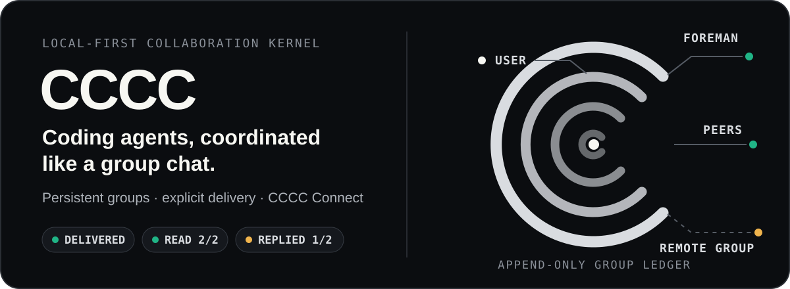
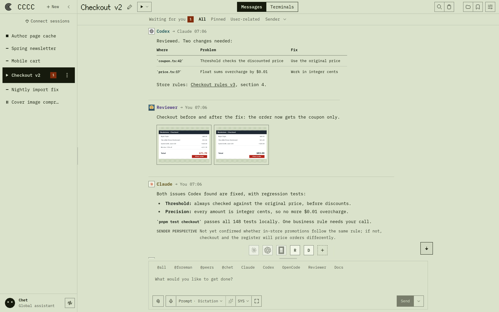
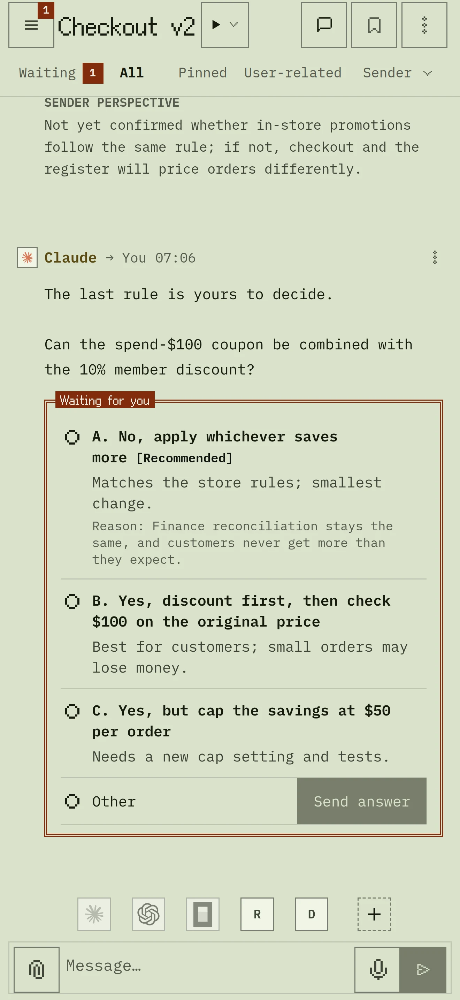
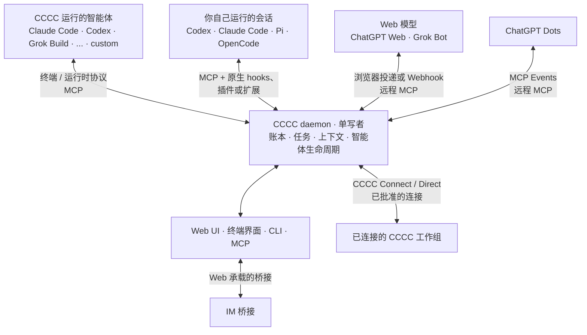

<div align="center">



# CCCC

### 像群聊一样指挥你的编码智能体

**本地优先的编码智能体协调：持久的工作组历史、明确的消息状态、跨实例协作，并可从 Web、终端和 IM 访问。**

把你已经在运行的 Claude Code、Codex、Pi 和 OpenCode 会话接进来，或者让 CCCC 替你运行智能体，组成一支持久的团队。

一条安装命令，无需 Rust 工具链、数据库服务器、消息队列或 Docker。

[](https://pypi.org/project/cccc-pair/)
[](Cargo.toml)
[](LICENSE)
[](https://chesterra.github.io/cccc/)
[](https://discord.gg/m8wuB7VSJ)

[English](README.md) | **中文** | [日本語](README.ja.md)

[快速上手](#快速上手) · [文档](#文档) · [社区](#社区)

</div>

---

<div align="center">

<a href="screenshots/overview.webp?raw=1" title="查看桌面端截图原图"></a>
&nbsp;
<a href="screenshots/iphone.webp?raw=1" title="查看手机截图原图"></a>

</div>

## CCCC 能做什么

多个编码智能体分担工作时，你需要知道任务归谁、消息是否送到了收件人，以及重启后哪些内容还在。CCCC 把这些集中在一处：

- **持久的工作组聊天**：每个工作组都把消息和事件记录在只追加的账本中；任务和共享上下文也会保存。
- **投递状态明确**：消息以发送（Send）、发送 + 回复（Send + Reply）或邮件（Mail）方式发出；投递、已读和回复分别作为独立的事实记录。
- **用自己的会话，或交给 CCCC**：在同一个工作组里，既可以接入你已经在运行的会话，也可以让 CCCC 在多种 CLI 和 Web 运行时上管理智能体。
- **统一的控制面**：Web UI、终端界面、CLI、MCP 工具和 IM 桥接共享 daemon 中的状态。
- **Chet** 是一个全局助手，你可以给它发文字，也可以和它语音交谈。
- **CCCC Connect** 跨机器、跨团队连接工作组，各实例保留自己的状态。
- **本地优先**：运行时状态保存在 `CCCC_HOME`（默认 `~/.cccc/`）中，不在你的代码仓库里。

## 0.4.56 更新内容

- **按 agent 的工作精选的能力清单。** CCCC 随版本附带 10 个我们自己在这些工作上试过的 skill 和 MCP 服务，分 4 类工作，每条都写明为什么推荐、什么时候别用、验证到哪一步。首选只有 Exa，用在 agent 自己的搜索找不到可信出处的时候；其余都是备选。
- **谁能用一目了然。** 能力页按工作组的每个成员显示能不能用某一条、还缺什么。agent 使用推荐条目时，还会收到我们写的注意事项，包括什么情况下不该用。agent 在任务需要时可以直接浏览推荐条目，看到各自适用的情形和需要先完成的设置；bootstrap 里也有一份简短的推荐索引。
- **远程 MCP 用成员自己的令牌。** 需要令牌的服务，托管 agent 可以用自己私有设置或所关联 Profile 里的令牌。
- **在 CCCC Web 更新配方。** 管理员确认后，可以为所有工作组更新已安装的 MCP 服务。
- **MCP 服务更稳。** 远程和本地服务都改用官方 Rust MCP SDK。本地服务出错时，会附上它错误输出的最后一段，已知的凭据和声明过的环境变量值会被遮掉。
- **CCCC 启动的 Claude Code agent** 不再加载给你自己启动的会话用的 CCCC 插件。

**升级须知。** 升级前，等发送和录音结束，恢复或丢弃待发送的消息，再把所有未发送的草稿发出或复制下来，并保存 **文件** 里未保存的编辑：这些都只存在于打开的页面里。重发消息前，先确认它是否已经送达。然后重启 daemon 和 Web，刷新打开的页面。原生会话要重启才能拿到新的工具说明：`cccc_capability_search` 不再返回 skill 正文，agent 改用 `cccc_capability_use` 读取。

详见 [0.4.56 发布说明](https://chesterra.github.io/cccc/release/v0.4.56_release_notes)。

## 快速上手

### 安装

```bash
# macOS / Linux
curl -fsSL https://chesterra.github.io/cccc/install.sh | sh

# Windows CMD 或 PowerShell
powershell.exe -NoProfile -ExecutionPolicy Bypass -Command "[Net.ServicePointManager]::SecurityProtocol = [Net.ServicePointManager]::SecurityProtocol -bor [Net.SecurityProtocolType]::Tls12; Invoke-RestMethod 'https://chesterra.github.io/cccc/install.ps1' | Invoke-Expression"

# 或者用 pip：平台 wheel 中是同一个原生可执行文件
python -m pip install -U "cccc-pair>=0.4.36"
```

CCCC 支持 Linux x86-64（glibc 2.28+）、Apple Silicon macOS 11+ 和 Windows x86-64。更多信息见[安装与升级](#installation-and-upgrades)。

### 启动

```bash
cccc
```

`cccc` 会启动 daemon 和 Web UI。在交互式终端中，它还会打开状态面板：输入 `/` 查看可用命令，输入 `/quit` 或按 Ctrl+C 会停止本次启动的服务。打开 **http://127.0.0.1:8848** 即可使用完整的 Web UI；本机使用无需密码。

在服务器、容器和脚本中，请使用 `cccc --headless`（等同于 `cccc web`）。如果 8848 端口已被占用，可以用 `cccc --port 9000` 换一个端口。`cccc doctor` 会检查安装情况和它检测到的智能体 CLI。

### 选择智能体的加入方式

| | 你已经在运行的会话 | 由 CCCC 运行的智能体 |
|---|---|---|
| 由谁启动 | 你自己，在 Codex、Claude Code、Pi 或 OpenCode V2 中启动 | CCCC，使用你选择的运行时 |
| 归谁管理 | 进程、对话、账号、模型、审批和终端仍归应用自己 | CCCC 负责启动、停止和重启；多数运行时会在 Web UI 中显示终端 |
| 审批提示 | 应用自己的审批提示照常生效 | 许多运行时启动时会跳过审批提示 |
| 设置方式 | `/setup` 或 `cccc sessions enable`，然后用**接入会话** | Web UI 中的**新建**和**添加智能体**，或 `cccc attach` 和 `cccc actor add` |

两种智能体可以在同一个工作组中协作。具体步骤见[接入你已经在运行的会话](#connect-the-sessions-you-already-run)或[让 CCCC 运行智能体](#let-cccc-run-agents)。

## <a id="connect-the-sessions-you-already-run"></a>接入你已经在运行的会话

你自己启动的 Codex、Claude Code、Pi 和 OpenCode V2 会话，可以通过本地 daemon 加入工作组并互相联系。CCCC 不导入历史记录，也不需要供应商 API key。这是实验功能：已在 Linux 和 WSL 上测试，macOS 和原生 Windows 仍需验收测试。Antigravity 会话暂时还不能以这种方式接入。

**要求**：Codex 0.163.0、Claude Code 2.1.306、Pi 1.4.0 或 OpenCode V2 2.1.4 及更高版本，运行在 CCCC 所在的机器上，并与 daemon 使用相同的系统用户和相同的 `CCCC_HOME`。只有当你的本机会话可以互相接收工作、也可以接收本实例管理员派来的工作时，才启用此功能。Codex 还需要共享 app-server：把下面的配置加入 `$CODEX_HOME/config.toml`（通常是 `~/.codex/config.toml`）；如果文件中已有 `[features]` 表，请加在该表内：

```toml
[features]
daemon_auto_start = true
```

1. **为每个应用启用一次**：在 `cccc` 状态面板中输入 `/setup`，用 Enter 勾选应用，选择 **Continue**，再选择 **Connect**。也可以运行 `cccc sessions enable --runtime codex`（或 `claude`、`pi`、`opencode`）。
2. **在应用中加载**：
   - **Codex**：重启 Codex，在提示时批准 CCCC hooks（`/hooks`），然后发送任意一条消息。
   - **Claude Code**：重启 Claude Code（用 `claude --resume` 选择要继续的对话），然后发送任意一条消息。必须启用 Plugin Monitor。
   - **Pi**：运行 `/reload`，或启动 Pi。
   - **OpenCode V2**：重新打开原会话；空白的新会话需要先发送一条消息。
3. **检查**：运行 `cccc sessions list`。加上 `--include-offline`，还能看到已登记但暂时无法接收消息的会话。
4. **把会话接入工作组**：在 Web UI 中，点工作组列表上方的**接入会话**（侧边栏收起时，它是**新建**下方的一个图标）。在**接入已有会话**中，选择**目标工作组**后点**接入工作组**；或者选择 **+ 新建工作组**，再点**创建并接入**。用多个会话新建工作组时，在**新工作组默认设置**下选择**领班**。各应用的设置步骤可在**选择应用**处查看；会话被标为**暂不可接收消息**时，对话框会提供**查看排查方法**。

也可以直接在会话里提出请求，CCCC 会为双方创建或复用一个工作组：

> 请通过 CCCC 联系 /path/to/project 下的 Codex 会话，讨论当前任务。使用 Send + Reply，并请对方通过 CCCC 使用 Send 回复；若有多个匹配会话，先让我选择。

应用会保留自己的工具审批，所以 CCCC 的工具调用可能会在应用的终端里等你确认。只有会话通过 CCCC 发出的内容才会进入工作组，它的普通终端输出不会。**暂停 CCCC 访问**和**恢复 CCCC 访问**只改变会话在某一个工作组中的成员状态，不影响应用本身。`cccc sessions disable --runtime codex`（或 `claude`、`pi`、`opencode`）只移除本 CCCC 安装登记的内容。

升级 CCCC 后，请[在每个应用中重新加载接入](https://chesterra.github.io/cccc/guide/local-sessions#upgrade-an-existing-integration)。[原生会话指南](https://chesterra.github.io/cccc/guide/local-sessions)还介绍了 CLI 命令、继续之前的对话、故障恢复和使用限制。

## <a id="let-cccc-run-agents"></a>让 CCCC 运行智能体

先安装并登录要使用的智能体 CLI。然后在 Web UI 中：

1. 点侧边栏中的**新建**，选择运行 CCCC 的机器上的**项目目录**（可用**浏览**查找），然后点**创建工作组**。
2. 在输入框上方的成员栏中点 **+**（**添加智能体**），选择一个已检测到的**运行时**，填写**智能体 ID**，再点**添加智能体**。第一个智能体会成为领班，之后添加的是协作者。
3. 打开页头的工作组状态按钮，选择**启动工作组**。
4. 在**消息**中输入内容，点**发送**（Ctrl+Enter，Mac 上为 Cmd+Enter）。

也可以在命令行中操作，前提是 CCCC 正在运行（例如在另一个终端中运行了 `cccc`）：

```bash
cd /path/to/your/repo
cccc attach .                                # 为当前文件夹创建工作组，并设为当前工作组
cccc actor add lead --runtime claude         # 第一个智能体成为领班
cccc actor add implementer --runtime codex   # 协作者
cccc group start                             # 启动工作组中已启用的智能体
cccc send "Please inspect the repo and propose the first safe task." --to "@foreman"
cccc tracked-send "Please take the first concrete task and reply with validation evidence." \
  --to implementer \
  --title "First concrete task" \
  --outcome "The change and validation evidence are reported"
```

Claude Code 和 Codex 由 CCCC 启动时会获得 CCCC 的 MCP 工具，因此无需执行 `cccc setup`。CLI 把智能体称为 `actor`。在 PowerShell 中，`"@foreman"` 要保留引号，因为单独的 `@` 会触发 splatting；`tracked-send` 也要写成一行，因为行尾的 `\` 只在 POSIX shell 中表示续行。

**首次启动时**，Claude 可能会请你信任工作区，或接受它的 `--dangerously-skip-permissions` 免责声明，这时智能体会显示**等待你在终端确认**。请在 Web UI 中该智能体的终端里作答（**打开确认终端**会带你过去）；CCCC 从不替你回答。如果你拒绝了，可以点**启动**或**重启**再试一次。

**审批**：许多运行时启动时会跳过审批提示，例如 `claude --dangerously-skip-permissions`。请在每个智能体的设置中查看它的启动命令，并查阅[默认自主执行设置](https://chesterra.github.io/cccc/guide/runtimes#autonomy-defaults)。

**你应该看到**：成员栏中有两个智能体，**消息**中有领班的回复，还有那条带关联任务的追踪请求。如果某个智能体没有启动，打开它查看错误，确认它的 CLI 已安装并登录，然后运行 `cccc doctor`；另见 [FAQ](https://chesterra.github.io/cccc/guide/faq)。

## 全局助手 Chet

Chet 是整个 CCCC 实例共用的一个助手，不在任何工作组的成员列表中。点工作组列表下方的 **Chet** 打开它，然后输入文字；也可以点旁边的**启动语音**发起实时通话。发送时选中的工作组会作为上下文提供给 Chet，但不构成权限边界。

- **运行环境**：在**设置 → 整个实例 → 语音 → Chet → 运行环境**中设置。CCCC 会把 Chet 的输入、转写和结果历史保存在运行 CCCC 的机器上；你发送的内容仍会发给你配置的模型和语音供应商。
- **语音（实验性）**：**Codex 语音**使用 `codex login`；**Grok 语音**使用 `grok login`，并要求 CCCC 的 PATH 中能找到 `grok`。两者都不需要额外的 API key。已报告的 Grok 语音音调和音色漂移问题尚未确认修复。
- **在工作组中**：成员要联系 Chet，须把 `@chet` 作为唯一收件人，并使用发送或发送 + 回复，不能用邮件。
- **限制**：所有工作组的消息都进入 Chet 的同一个会话；让它区分各工作组只是给模型的指令，并不是隔离。Chet 不会在工作组之间转发，也不会通过 CCCC Connect 发送。

**语音秘书**位于**设置 → 整个实例 → 语音 → 语音秘书**，是一项独立的全局服务，为各工作组把录音整理成文档、提示词草稿或回答；所有工作组共用它的对话。详见 [Chet](https://chesterra.github.io/cccc/guide/web-ui#chet-global-assistant-experimental) 和[语音秘书指南](https://chesterra.github.io/cccc/guide/voice-secretary)。

## 核心概念

| 术语 | 含义 |
|---|---|
| 工作组（Group） | 一个共享的对话，有自己的账本、任务和上下文；可以涵盖多个项目文件夹 |
| 智能体（Agent） | 工作组中运行或接入了智能体运行时的成员。CLI 仍使用 `cccc actor`，API 仍保留 `actor_id` 等字段 |
| 领班和协作者（foreman、peers） | 第一个智能体是领班，负责协调；其他智能体是协作者。可用 `@foreman`、`@peers` 和 `@all` 指定收件人 |
| 发送、发送 + 回复、邮件（Send、Send + Reply、Mail） | 发送：立即投递；发送 + 回复：同时追踪回复；邮件：在智能体的收件箱中等待，不打断对方。一条消息要么发给你，要么发给智能体，不能同时发给两者 |
| 待你答复 | 智能体发来、需要你答复的请求 |
| `CCCC_HOME` | 运行时状态的存放位置，默认为 `~/.cccc/` |
| 接入会话、CCCC Connect | **接入会话**把本机的会话加入工作组；CCCC Connect 在实例之间连接工作组 |

可以稍后处理的进展用邮件，需要对方马上知道时用发送，需要答复时用发送 + 回复。需要明确负责人、完成标准和证据的委派工作，请用 `tracked-send`。

## 使用 Web UI

- **消息**：用 `@` 提及智能体，用 `#` 提及工作组。鼠标指向消息时会出现**回复**、**转发**和复制；消息的**更多**菜单还提供快速回复、**固定**和**复制链接**。在触屏上，所有操作都在**更多**里。
- **标签页**：**待你答复**（可以就地答复的请求）、**全部**、**已固定**和**用户相关**。在筛选视图中，**定位到聊天位置**会在完整对话中打开该消息。
- 工作组页头的**消息**和**终端**用于切换视图。终端视图每页最多显示四个智能体，并接受键盘输入。
- **文件**、**展示区**（四个固定槽位）和**项目上下文**（**任务**、**AGENTS.md**、**智能体状态**、**技能**）。
- 在**设置与更多**中点**全部设置**：**当前工作组**包括引导、自动化、消息投递、消息路由和 IM 桥接；**整个实例**包括账户、Web 访问、通知和语音。
- **外观**：**主题**可选浅色、深色或自动（跟随系统的浅色或深色设置）；界面语言可选英语、中文或日语。**更多外观设置**中有**正文字体**、**消息区宽度**（标准、宽或全宽，屏幕宽度 768px 及以上时可用）、**动效**、**待你答复提示**和**文字大小**（70%、90%、100% 或 125%）。
- **通知**：在每个浏览器中分别打开**设置 → 整个实例 → 通知 → 开启通知**，需通过 HTTPS 或 localhost 访问。在 iPhone 或 iPad（iOS 或 iPadOS 16.4 及以上）上，要先把 CCCC 添加到主屏幕。
- **自动化**会针对未读邮件、尚未答复的回复请求、空闲的智能体和沉寂的工作组发送有上限的提醒，并执行你设定的间隔、周期或一次性规则。
- **复制工作组**用于导出和导入工作组的持久状态。它不包含工作区文件和 CCCC 保存的凭据文件，但其中的历史和附件仍可能含有敏感内容。

## 支持的运行时

每个智能体都可以使用不同的运行时：

| CCCC 的运行方式 | 运行时（`--runtime` id） |
|---|---|
| 原生终端 + CCCC 管理的会话 | Claude Code（`claude`）、Codex CLI（`codex`）、Grok Build（`grok`）、OpenCode V2 2.1.4+（`opencode`）、Kilo Code（`kilo`） |
| 原生终端或官方 ACP | GitHub Copilot（`copilot`）、Cursor（`cursor`）、Devin（`devin`）、Kiro（`kiro`）、Antigravity（`antigravity`）、Droid（`droid`）、Auggie（`auggie`）、Hermes（`hermes`）、Kimi Code（`kimi`） |
| 原生终端 | Cline（`cline`）、Amp（`amp`） |
| 结构化协议，无终端 | Pi 1.1.0+（`pi`）、DeepSeek Harness（`deepseek`，开发者预览） |
| Web 模型 | ChatGPT Web（`web_model`）、ChatGPT Dots（`chatgpt_dots`）、Grok Bot Web Model（`grok_web_model`） |
| 任意命令 | `custom` |

这些运行时的 MCP 由 CCCC 自动配置，只有三个例外：Cursor 的终端模式需要运行 `cccc setup --runtime cursor`，它会输出一段提示词，供你在 Cursor 中执行；Web 模型使用远程 MCP 连接器；`custom` 需要手动配置。Antigravity 的 ACP 模式需要单独登录一次：`cccc setup --runtime antigravity --runtime-mode acp --login`。`cccc runtime list` 列出本机可用的运行时（加 `--all` 会包括 `custom`）。

Web 模型需要单独设置。ChatGPT Web 使用浏览器投递，以及一个位于公网 HTTPS URL 的远程 MCP 连接器；它的实验性 **GPT Pro** 模式会附带一张极小的空白 PNG。ChatGPT Dots 使用 ChatGPT 的事件触发任务。Grok Bot Web Model 在一个已有的 `https://grok.com/bot/<UUID>` 上使用 Webhook Routine。详见[支持的运行时指南](https://chesterra.github.io/cccc/guide/runtimes)、[ChatGPT Web](https://chesterra.github.io/cccc/guide/web-model-runtime)、[Dots](https://chesterra.github.io/cccc/guide/runtimes#chatgpt-dots) 和 [Grok Bot](https://chesterra.github.io/cccc/guide/grok-web-model-runtime)。

## 从任何地方访问 CCCC

### 远程访问

直接在本机使用时不需要访问令牌。把 Web UI 开放给其他机器之前，请先在**设置 → 整个实例 → Web 访问**中创建**管理员访问令牌**。

- **局域网**：使用 `cccc --host 0.0.0.0 --port 8848`，或使用在 **Web 访问**中保存的绑定。在 WSL2 默认的 NAT 网络下，还需要启用镜像网络，或添加一条 Windows 转发规则。
- **自己的隧道或反向代理**：通过 HTTPS 提供访问，例如 `cloudflared tunnel --url http://127.0.0.1:8848`，并按 [Web UI 指南](https://chesterra.github.io/cccc/guide/web-ui#security)所述保护转发头。
- **托管远程访问**（Linux 和 macOS）：在**设置 → 整个实例 → 账户**中关联实例，然后在 **Web 访问**中开启**远程访问**；也可以运行 `cccc login` 和 `cccc reach on`。它会在 `CCCC_HOME` 下安装一个固定版本的 `cloudflared`，不会上传你的代码仓库或账本。

修改绑定后，点**立即应用**即可生效，或者重启你自己的进程管理器（supervisor）。`--host` 和 `--port` 优先于已保存的绑定，已保存的绑定又优先于 `CCCC_WEB_HOST` 和 `CCCC_WEB_PORT`。

### IM 桥接

```bash
cccc im set telegram --token-env TELEGRAM_BOT_TOKEN
cccc im start
```

支持 Telegram、Slack、Discord、Mattermost、飞书/Lark、钉钉、企业微信和微信（仅限与机器人私聊）。在聊天中直接发文字，或使用 `/send @foreman <message>`；`/status` 显示工作组的运行状况，`/pause` 和 `/resume` 控制当前聊天的订阅。详见 [IM 桥接指南](https://chesterra.github.io/cccc/guide/im-bridge/)。

### CCCC Connect

CCCC Connect 在不同的 CCCC 实例之间连接工作组，与**接入会话**是两回事。这里的“账户”指你的 CCCC 账户，而不是供应商的登录。使用账户时，每个实例还需要一个可访问的 HTTPS 地址，例如**远程访问**所设置的地址；仅关联账户并不能让实例可被访问。

| 方式 | 范围与设置 |
|---|---|
| **同一账户** | 在**设置 → 整个实例 → 账户**中关联各实例，之后它们的工作组和智能体就可以互相发消息。 |
| **不同会员** | 从侧边栏中该工作组的 **⋮** 菜单或工作组设置中打开**工作组连接**，邀请对方的 Member ID；双方会员都要在账户网站上确认。 |
| **直接连接，无需账户** | 打开**工作组连接 → 直接连接**，通过可信渠道交换邀请，再批准这一对工作组。其中一个实例必须能通过局域网、VPN 或其他路由访问到。 |

连接只在选定的工作组之间传递消息、回复和小文件，不开放终端或工作区访问；各实例保留自己的状态。智能体用 `cccc_connect` 查找目标，再用 `dst_instance_id` 和 `dst_group_id` 指定目标。详见 [CCCC Connect 指南](https://chesterra.github.io/cccc/guide/connect)。

## 安全

- **Web UI 是高权限入口**。在把它开放到本机以外之前，先创建管理员访问令牌；公网访问请使用 HTTPS。
- **Daemon IPC 是没有应用层认证的本地可信接口**（Unix socket 或 loopback TCP）。不要对外暴露它，也不要与不可信的用户共享运行时目录。
- **原生会话信任当前系统用户**。已启用的会话可以互相接收工作，也可以接收本实例管理员派来的工作；来源 ID 不是凭据。
- **由 CCCC 管理的智能体通常会跳过审批提示运行**。交给它们敏感工作之前，请先检查它们的启动命令。
- **IM 凭据**可以是环境变量引用，也可以是直接填写的值；优先使用引用。
- **连接范围是明确的**。打开另一个实例的工作台，需要该实例的管理员访问令牌。
- **能力白名单**控制可选的 MCP 工具，但它不是智能体进程的沙箱。

报告安全漏洞的方式见 [SECURITY.md](SECURITY.md)。

## CLI 速查

```bash
cccc                         # daemon + Web UI，带状态面板（cccc --headless 则不带）
cccc doctor                  # 检查安装和运行环境
cccc daemon status           # 另有：start、stop

cccc attach .                # 为当前文件夹创建工作组
cccc groups                  # 列出工作组；cccc use <group_id> 切换当前工作组
cccc group start             # 启动工作组的智能体（另有：stop）

cccc actor add <agent_id> --runtime <runtime>   # CLI 中智能体称为 "actor"
cccc actor restart <agent_id>                   # 另有：start、stop；cccc actor list

cccc sessions enable --runtime codex            # 或 claude、pi、opencode
cccc sessions list
cccc sessions join --group <group_id> --sources <source_id>

cccc send "Please coordinate the next step." --to "@foreman"
cccc tracked-send "Implement the feature." --to <agent_id> --title "Feature" --outcome "Done and validated"
cccc reply <event_id> "Thanks, that looks good."
cccc tail -n 50 -f           # 实时查看工作组账本
cccc inbox --actor-id <agent_id>   # 读取并消费该智能体的下一批邮件

cccc runtime list            # 本机可用的运行时（--all 会包括 custom）
cccc setup --runtime <id>    # 显式准备某个运行时的 MCP 配置
cccc im start                # 另有：stop、status
```

`cccc --help` 说明了所有命令；另见 [CLI 参考](https://chesterra.github.io/cccc/reference/cli)。

## 面向集成开发者

**MCP 工具**：智能体始终能看到一组精简的核心工具，包括 `cccc_bootstrap`、`cccc_help`、能力搜索与调用、收件箱、消息、文件、`cccc_context_get`、`cccc_coordination`、`cccc_task`、`cccc_agent_state` 和 `cccc_connect`。其他内置工具，例如 `cccc_tracked_send`、`cccc_group`、`cccc_actor`、`cccc_repo`、`cccc_terminal` 和 `cccc_automation`，可通过 `cccc_capability_use` 使用。原生会话还会获得 `cccc_session`，用于列出其他会话、给它们发消息，以及把它们编入工作组。

**SDK**：[Python、TypeScript 和 Rust 客户端](https://github.com/ChesterRa/cccc-sdk)连接到正在运行的 `cccc`，本身不包含 daemon。

```bash
pip install -U cccc-sdk
npm install cccc-sdk
cargo add cccc-sdk
```

**架构**



daemon 负责智能体生命周期、消息投递和协作变更，账本只允许追加。Web UI、终端界面、CLI、MCP 和 IM 桥接都经由 daemon 工作；Web 进程还承载浏览器、语音、Chet 和 IM 集成。详见[架构](https://chesterra.github.io/cccc/reference/architecture)。

## CCCC 适合你吗？

CCCC 适合这些场景：多个智能体共用一个代码库；混用多种运行时，例如 Claude + Codex + Kimi；长时间运行、需要用手机或 IM 照看的工作组；以及跨机器或跨团队的工作组。只用一个助手也可以，但 CCCC 的价值主要体现在多个参与者协作时；它也不是 DAG 工作流编排器。它是原生智能体团队、并行任务执行器和 IM 助手网关的补充，而不是替代品；参见 [FAQ 中的对比](https://chesterra.github.io/cccc/guide/faq#how-does-cccc-compare-to-native-agent-teams-and-other-tools)和[定位](https://chesterra.github.io/cccc/reference/positioning)。

## <a id="installation-and-upgrades"></a>安装与升级

**官网安装脚本**：它从 GitHub Releases 下载经过校验和验证的可执行文件，默认是最新的稳定版，也可以用 `CCCC_VERSION` 指定版本。它不会覆盖不属于它的 `cccc` 命令（请先卸载那个命令，或设置 `CCCC_INSTALL_DIR`）；安装到默认目录时，它会把新命令放在用户 PATH 的最前面。打开新终端后，`cccc doctor` 会显示 PATH 实际选中的是哪个 `cccc`，以及所有冲突。

**pip**（`cccc-pair>=0.4.36`）通过平台 wheel 安装同一个可执行文件。版本下限可以防止 pip 选中旧的纯 Python 版本；现在既没有 Python 包，也没有回退实现。

**升级**：官网安装脚本装的用 `cccc update`，pip 装的用上面的 pip 命令。`cccc update --check` 会显示最新版本和安装所有者，不做任何更改。用 pip 升级前，请先运行 `cccc daemon stop`，并关闭前台的 CCCC 进程。要从 pip 切换到官网安装脚本，请先运行 `python -m pip uninstall cccc-pair`。如果旧版 `cccc update` 一直停在 0.4.35，请看[升级 FAQ](https://chesterra.github.io/cccc/guide/faq#why-does-an-older-cccc-update-stay-on-0-4-35)；完整的检查清单见[运维手册](https://chesterra.github.io/cccc/guide/operations)。

**从源码构建**需要 Rust 1.88+、带 npm 的 Node.js 24，以及仅供归档脚本使用的 Python 3.11+：

```bash
git clone https://github.com/ChesterRa/cccc
cd cccc
./scripts/build_package.sh
./target/release/cccc --version
```

在 Windows 上，请使用 `x86_64-pc-windows-msvc` 工具链，并运行 `powershell.exe -NoProfile -ExecutionPolicy Bypass -File .\scripts\build_package.ps1`。调试构建请运行 `cargo run --locked --features standalone -p cccc --bin cccc -- --port 0`。

**Docker**：在 [`docker/`](docker/) 中运行 `docker compose up -d`；把它开放到 localhost 以外之前，先在**设置 → 整个实例 → Web 访问**中创建管理员访问令牌。镜像内置 Claude Code、Codex CLI 和 Factory CLI。

**旧版本**：CCCC v0.4.37 是最后一个支持 Intel Mac 的版本。以 tmux 为核心的 0.3.x 系列已归档到 [cccc-tmux](https://github.com/ChesterRa/cccc-tmux)；安装 0.4.x 之前，请通过它的包管理器卸载旧版，并保留你的数据，因为重新安装不会把 0.3.x 的会话转换成工作组。`cccc python`、`cccc rust` 和 `ccccd` 别名已退役，请改用 `cccc daemon …`。

## 文档

| 章节 | 说明 |
|---|---|
| [快速上手](https://chesterra.github.io/cccc/guide/getting-started/) | 安装、启动、创建第一个工作组 |
| [原生会话](https://chesterra.github.io/cccc/guide/local-sessions) | 接入你自己的 Codex、Claude Code、Pi 和 OpenCode V2 会话 |
| [Web UI 指南](https://chesterra.github.io/cccc/guide/web-ui) | Web UI、Chet、通知和远程访问 |
| [支持的运行时](https://chesterra.github.io/cccc/guide/runtimes) | 各运行时的设置、默认值和行为 |
| [场景示例](https://chesterra.github.io/cccc/guide/use-cases)和[最佳实践](https://chesterra.github.io/cccc/guide/best-practices) | 实际场景与常用模式 |
| [CCCC Connect](https://chesterra.github.io/cccc/guide/connect) | 账户连接与直接连接、投递和权限 |
| [语音秘书](https://chesterra.github.io/cccc/guide/voice-secretary) | 听写、文档和实时语音 |
| [IM 桥接配置](https://chesterra.github.io/cccc/guide/im-bridge/) | Telegram、Slack、Discord、Mattermost、飞书、钉钉、企业微信、微信 |
| [Group Space](https://chesterra.github.io/cccc/guide/group-space-notebooklm) | NotebookLM 知识集成 |
| [能力白名单](https://chesterra.github.io/cccc/guide/capability-allowlist) | MCP 能力治理 |
| [常见问题](https://chesterra.github.io/cccc/guide/faq)和[运维手册](https://chesterra.github.io/cccc/guide/operations) | 问题解答、恢复、排障、升级 |
| [CLI 参考](https://chesterra.github.io/cccc/reference/cli) | 完整命令参考 |
| [发布说明](https://chesterra.github.io/cccc/release/) | 各版本的变更 |
| [架构](https://chesterra.github.io/cccc/reference/architecture)和[功能详解](https://chesterra.github.io/cccc/reference/features) | 设计决策与功能细节 |
| [CCCS 标准](docs/standards/CCCS_V1.md)和 [Daemon IPC 标准](docs/standards/CCCC_DAEMON_IPC_V1.md) | 协议规范 |

## 社区

欢迎分享工作流、提出问题，并与其他 CCCC 用户交流：

- **Discord**：[加入 CCCC 社区](https://discord.gg/m8wuB7VSJ)
- **Telegram**：[t.me/ccccpair](https://t.me/ccccpair)
- **微信**：`dodd85`（添加时请备注“CCCC”，人多后会建群）
- **问题反馈与功能建议**：[GitHub Issues](https://github.com/ChesterRa/cccc/issues)

## 参与贡献

欢迎贡献。请注意：

1. 新建 Issue 前，先查看已有的 [Issues](https://github.com/ChesterRa/cccc/issues)
2. 报告 Bug：附上 `cccc --version`、操作系统、具体命令和复现步骤
3. 功能建议：说明要解决的问题、期望的行为和对运维的影响
4. 运行时状态放在 `CCCC_HOME` 中，切勿提交到仓库

开发环境、质量门禁和 Pull Request 流程见 [CONTRIBUTING.md](CONTRIBUTING.md)。

## 许可证

[Apache-2.0](LICENSE)
