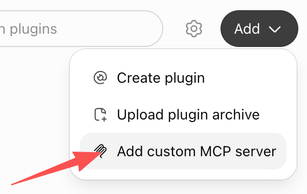

# Supported Runtimes

CCCC can run multiple agent runtimes in the same working group. Each actor chooses one runtime, while the daemon keeps messaging, delivery tracking, tasks, context, and Web/IM control in one shared CCCC group.

Use `cccc runtime list --all` to see the full supported list on your machine, and `cccc doctor` to check which CLI runtimes are installed.

## First-Class Runtimes

| Runtime | Runtime id | Entrypoint / surface | MCP setup |
|---------|------------|----------------------|-----------|
| Claude Code | `claude` | CCCC-managed Agent View session + native TUI | Injected into each managed session |
| Cline CLI | `cline` | `cline` | Auto |
| Codex CLI | `codex` | `codex` | Auto |
| DeepSeek Harness | `deepseek` | CCCC-managed `dsh-acp-demo` (structured ACP, no native terminal) | Automatic on first start; explicit setup remains available |
| GitHub Copilot CLI | `copilot` | `copilot` | Auto |
| Cursor CLI | `cursor` | `cursor-agent` | Prompt-assisted |
| Devin CLI | `devin` | `devin` | Auto |
| Kiro CLI | `kiro` | Native TUI or official V3 ACP | Native registration for TUI; injected per ACP session |
| Kilo Code CLI | `kilo` | CCCC-managed ACP + authenticated native TUI attach | Injected into each managed session |
| Antigravity CLI | `antigravity` | Native `agy` TUI or official ACP | Native registration for TUI; injected into each ACP session |
| Droid CLI | `droid` | Native TUI or official ACP | Native registration for TUI; injected per ACP session |
| Amp | `amp` | `amp` | Auto |
| Auggie (Augment) | `auggie` | Native TUI or official ACP | Native registration for TUI; injected per ACP session |
| Grok Build | `grok` | CCCC-managed Grok leader + ACP + native TUI | Automatic native MCP registration; identity inherited per session |
| Hermes Agent | `hermes` | Native TUI or official ACP | Native user profile for TUI; injected per ACP session |
| Kimi Code | `kimi` | Native TUI or official ACP | Native registration for TUI; injected per ACP session |
| OpenCode | `opencode` | CCCC-managed ACP + authenticated native TUI attach | Injected into each managed session |
| Pi | `pi` | Official RPC (headless; no native terminal attachment) | Injected per managed session |
| ChatGPT Web Model | `web_model` | Bound ChatGPT Web conversation | Browser delivery + remote MCP connector |
| ChatGPT Dots | `chatgpt_dots` | One explicitly bound Dot | MCP Events + task-scoped remote MCP; no browser message delivery |
| Grok Bot Web Model | `grok_web_model` | Dedicated Grok Bot URL | Browser delivery + credential-routed remote MCP connector |

`custom` is also supported as a manual fallback for any command-line agent that can be launched by CCCC.

## Autonomy Defaults

CCCC applies runtime-specific launch defaults for actors it starts. These defaults are intended to keep agent sessions moving without repeated approval prompts, while still leaving actor/profile commands editable in the Web settings.

| Runtime id | Default command | Permission / autonomy behavior |
|------------|-----------------|--------------------------------|
| `claude` | `claude --dangerously-skip-permissions` | Skips Claude Code permission prompts. |
| `cline` | `cline --tui --auto-approve true` | Opens Cline's interactive TUI and enables tool auto-approval. |
| `codex` | `codex -c check_for_update_on_startup=false -c shell_environment_policy.inherit=all --dangerously-bypass-approvals-and-sandbox --search` | Bypasses Codex approvals/sandbox and preserves actor environment inheritance for MCP subprocesses. |
| `deepseek` | CCCC-managed `dsh-acp-demo --config …/cordis.yml` | Official ACP app composition; provider permission requests are rejected rather than implicitly approved. |
| `copilot` | `copilot --allow-all` | Allows Copilot CLI tool execution without per-action approval. |
| `cursor` | `cursor-agent --yolo --approve-mcps` | Uses Cursor YOLO mode and approves MCP usage. |
| `devin` | `devin --permission-mode dangerous` | Uses Devin's dangerous permission mode. |
| `kiro` | `kiro-cli chat --trust-all-tools` | Trusts Kiro tools for the session. |
| `antigravity` | `agy --dangerously-skip-permissions` | Skips Antigravity tool permission prompts. |
| `droid` | `droid --auto high` | Starts Droid in high-autonomy mode. |
| `grok` | `grok --always-approve` | Starts Grok Build with approval prompts bypassed. |
| `hermes` | `hermes --tui --yolo` | Starts Hermes in TUI YOLO mode. |
| `kimi` | `kimi --yolo` | Ask When Needed: routine actions are automatic; risky actions and questions can still ask. Use an explicit `kimi --auto` command for Never Ask mode. |
| `pi` | `pi` | Uses official RPC; project trust and native-tool permissions remain Pi's responsibility. Extension decisions remain explicit user interactions. |
| `opencode` | `opencode --auto` | CCCC owns the ACP permission boundary and selects only request-scoped one-time approval; it never writes a persistent provider approval. |
| `amp` | `amp` | No extra CCCC launch flag; Amp's current CLI default is already direct tool execution. |
| `auggie` | `auggie` | Use Auggie permissions or settings for per-tool approval policy; CCCC does not inject a broad wildcard permission rule. |
| `kilo` | `kilo` | Same request-scoped ACP approval policy as OpenCode; no persistent provider approval is written. |
| `web_model` | N/A | Browser-delivered runtime; local CLI launch flags do not apply. |
| `chatgpt_dots` | N/A | Event-triggered cloud runtime; CCCC Actor permissions apply to each accepted task. |
| `custom` | User command | CCCC preserves the user-provided command exactly. |

CCCC disables Codex startup update checks by default so an interactive upgrade
menu cannot block a session or consume messages intended for it. The managed
app-server and native terminal share this default, including when using a custom
executable path. Operators manage CLI upgrades through the original installation
channel; CCCC does not modify the global `config.toml`. To restore update checks,
explicitly add `-c check_for_update_on_startup=true` to the Actor or Runtime Profile
command. This setting does not resolve incompatible versions or expired sign-ins.

## Setup Commands

Most CLI runtimes can be prepared with `cccc setup --runtime <id>`:

```bash
cccc setup --runtime claude
cccc setup --runtime cline
cccc setup --runtime codex
cccc setup --runtime deepseek
cccc setup --runtime copilot
cccc setup --runtime devin
cccc setup --runtime kiro
cccc setup --runtime droid
cccc setup --runtime amp
cccc setup --runtime auggie
cccc setup --runtime grok
cccc setup --runtime hermes
cccc setup --runtime kimi
cccc setup --runtime opencode
cccc setup --runtime pi
cccc setup --runtime kilo
cccc setup --runtime antigravity
```

DeepSeek Harness is an upstream developer preview, so CCCC owns and isolates the tested ACP composition. On first use, it installs only the four required packages (`dsh-acp`, `dsh-mcp-client`, `dsh-acp-demo`, and `dsh-llm-deepseek`) under `CCCC_HOME/runtimes/deepseek/<release>`. Exact direct versions plus an npm release cutoff keep every transitive `@deepseek-ai/dsh*` package on the same validated preview release. The managed LLM adapter caps output at 65,536 tokens so prompt and MCP tool context retain headroom inside the model window. Setup also prunes the obsolete direct `dsh` bundle and its managed profile patch from earlier preview installs. CCCC does not modify `~/.dsh` or a project `package.json`; the legacy one-shot `dsh --profile cccc-acp` path and its unused bundle profile are not used. Concurrent starts share one setup lock, and a failed installation remains retryable. Running `cccc setup --runtime deepseek` performs the same idempotent setup eagerly. Provider credentials such as `DEEPSEEK_API_KEY` remain deployment inputs and are never generated or persisted by setup.

Prompt-assisted runtimes print an idempotent setup prompt or contract that you run inside that runtime:

```bash
cccc setup --runtime cursor
```

For a custom runtime, provide the command when creating or editing the actor:

```bash
cccc actor add worker --runtime custom --command "my-agent --with-flags"
```

## Runtime interaction

Users choose a Runtime, not an arbitrary runner. Antigravity, Auggie, Copilot, Devin, Cursor, Kimi Code, Kiro, Hermes and Droid offer an explicit official ACP mode without a terminal. Pi uses its official RPC surface by default and has no same-session native terminal attachment. Other CLI runtimes expose their native terminal so the user can inspect and operate the Actor. Codex, Claude Code, Grok Build, OpenCode, and Kilo additionally run a structured background protocol against the same provider session; CCCC uses that protocol for identity, lifecycle, progress, completion, and cancellation.

Actor messages still enter those managed Runtimes through their native terminal. CCCC does not decide whether a message steers an active turn or waits behind it; the receiving Runtime applies its own configuration. DeepSeek Harness has only a structured ACP surface, while ChatGPT Web Model uses browser delivery plus a remote MCP connector. These are Runtime capabilities, not user-selectable modes.

Cline currently opens a fresh native terminal on each start. CCCC does not persist or reuse Cline's `--id` session identifier.

#### Admission evidence (2026-09-05)

Kilo 7.5.14 was checked with the installed native CLI, isolated provider homes,
and a loopback test model. The shared Actor/Analyst probe covers idle startup,
empty and populated session resume, consecutive results, native TUI cancellation,
and a busy-state follow-up exceeding 16,000 characters. A second probe checks
that a submitted native model/variant selection reaches ACP. These probes do not
use real provider credentials or paid inference. They do not establish native
Windows or macOS behavior; those remain platform validation boundaries.

Kilo can publish temporary snapshot-initialization progress as text parts marked
`metadata["kilocode.lifecycle"]="transient"`. CCCC leaves that progress in the
native TUI and excludes it from Actor/Analyst answer text, including later
streaming updates to the same part. Ordinary answer text is preserved even
when synthetic or containing the same words as a progress label.

Windows npm installs (`npm install -g @kilocode/cli`, or a project-local install)
expose `kilo.cmd`. CCCC resolves that official entrypoint to Node plus the
installed Kilo launcher for both ACP and TUI; no manual `kilo.exe` path is needed.
Node must be available beside the npm shim or on the configured `PATH`.
Windows CI separately exercises npm installation layouts, literal arguments and
environment, owned stdio launch, and native terminal launch with an offline fixture.
That fixture does not substitute for full real-Kilo platform validation.

Cline 3.0.61 is **not** admitted as a managed Analyst. Its ACP `session/new`
returns an ID before the core/session history exists; immediately loading that
empty ID reproducibly returns `Resource not found`. The
[upstream ACP implementation](https://github.com/cline/cline/blob/dac3b35/apps/cli/src/acp/acpAgent.ts)
starts its core lazily on a prompt. A shared native TUI/controller would need
additional Hub/session lifecycle work, not simply the existing ACP adapter.
CCCC keeps its current terminal Actor support instead of creating a synthetic
startup prompt or a second Analyst-only session path.

The Linux CI runs the real Codex/Claude empty-session probes and both Kilo probes
against pinned CLI versions. To repeat the Kilo checks locally after building
the current `cccc` binary:

```bash
CCCC_LAUNCHER_PATH="$PWD/target/debug/cccc" \
CCCC_KILO_MANAGED_LIVE=1 CCCC_KILO_MODEL_SYNC_LIVE=1 \
  cargo test -p cccc-pair-daemon --lib --locked live_kilo -- --test-threads=1
```

Codex 0.153.2 Esc was also checked through CCCC against a local test model. The
interrupted turn published `turn_aborted`; an already queued follow-up could then
start a new turn. This is not evidence that CCCC swallowed Esc, so the keyboard
and cancellation paths were not changed. Do not discard queued user messages
merely to make the terminal appear idle.

### Kimi Code native TUI

The `kimi` runtime targets [Kimi Code](https://github.com/MoonshotAI/kimi-code)
(`@moonshot-ai/kimi-code`), not the former Python `kimi-cli`. Install the current
client and launch CCCC from a new terminal if its installer changed your `PATH`.
Actor commands, Runtime Profiles, and private environment variables remain the
normal configuration surface. Native TUI mode does not provide Voice Analyst
or Secretary controls; choose official ACP for those workflows, as described below.

Native Actor startup and `cccc setup --runtime kimi` use the same MCP setup implementation.
It updates only `mcpServers.cccc` in `$KIMI_CODE_HOME/mcp.json`, defaulting to
`~/.kimi-code/mcp.json`, without replacing other servers or malformed files.
It never guesses a data root from a leftover `.kimi` directory or calls the
removed `kimi mcp add` command. A project-level `.kimi-code/mcp.json` takes
precedence: a conflicting `cccc` entry must be corrected or removed by the
operator, and is not silently overwritten or reported as ready.

On first use, complete Kimi's workspace trust and login/model setup in its native
terminal **before sending CCCC messages**. Enabling bracketed paste does not prove
that Kimi has left those dialogs. CCCC does not pre-approve trust or detect
completion of these dialogs; input sent too early may be consumed by a dialog. An
initialized Kimi Code 2.1.1 TUI accepts the normal single Enter submit, including
multiline input. CCCC does not add a second Enter based on older client behavior.

To resume a specific Kimi session, use `kimi --session <id> --yolo` in the Actor's
native-mode custom command or Runtime Profile. In native TUI mode, CCCC preserves that command but does not capture Kimi session IDs or automatically resume them. ACP uses the separate verified receipt described below. Avoid adding `--continue`
to a shared profile: it selects the most recent session in the working directory,
which may belong to another Actor. Use Kimi's own `/new` command or remove the
explicit resume argument to start a new provider conversation.

### Delivery and recovery

A successful Send means that CCCC durably appended the message. For each
concrete recipient, `runtime.delivery` records
`claimed` before external I/O and then `accepted`, `failed`, or `ambiguous`.
Concurrent claimants treat `claimed` as in progress. On daemon restart, a claim
without an outcome is settled to `ambiguous` and is not retried automatically.

Current-generation Send work with no accepted/ambiguous evidence can be
recovered in ledger order after actor/group activation. Mail is never promoted
by recovery: it remains in the Inbox until `cccc_inbox_read`, apart from the
single bounded content-free Mail notice. Within the current actor generation,
legacy `chat.read.event_id` remains an inclusive ledger watermark rather than a
per-event receipt. Recovery excludes `system.notify` records at or before the
furthest valid watermark, plus later notices that reference an event in that
read prefix, so an upgrade cannot replay old unread nudges into a new provider
session. Runtime handoff never advances the Inbox cursor.
Restarting a provider process does not transfer its transient input mode or hot
terminal ring; durable ledger, Mail cursor, reply-obligation, and
runtime-delivery facts remain the recovery authority.

Starting, restarting, creating a new session, or restoring after daemon startup
does not count as Actor work and never submits a synthetic model turn. CCCC
creates or reconnects the managed control session and opens its native terminal
while the model remains idle. The first successfully accepted real CCCC delivery
also carries the pending startup instructions; a rejected delivery leaves them
pending. Human terminal input is likewise real work, but lifecycle operations
alone are not.

### Managed Codex/Claude/Grok/OpenCode/Kilo sessions

For every Codex Actor, CCCC creates one
daemon-owned app-server thread and opens Codex's writable remote TUI against
that exact thread. The configured executable must implement the Codex
app-server command; unsupported subcommands, wrappers, or prompt tails fail
explicitly instead of selecting another transport. The
app-server and TUI receive the same executable, model, Codex Profile, supported
`-c` overrides, YOLO policy, and private environment; only the host receives
the actor-scoped CCCC MCP and listener arguments. Provider events are the
working-state and completion authority, while Actor deliveries go immediately
through the native TUI so Codex applies its own queue/steer policy. Stop/start
resumes the same validated thread, while `actor new-session` deliberately
creates a new one. Voice Analyst uses this same Codex host/remote-TUI substrate,
with a global user MCP identity and its own warm lifecycle instead of Actor
identity and Group lifecycle.

A new Codex thread is made durable through native metadata operations before
the TUI attaches; an ID or planned rollout path alone is not a resumable history.
Starting or restarting an idle Actor does not submit a bootstrap prompt or run
the model. An empty thread can be stopped and resumed without first sending a
message.

Direct Claude Code Actors require Claude Code 2.1.259 or newer. Before first use,
accept Claude's bypass-mode disclaimer interactively with
`claude --dangerously-skip-permissions` under the same Claude configuration.
Use the Claude executable selected by the Actor or Analyst's Runtime Profile and
the effective `CLAUDE_CONFIG_DIR` shown in the launch error. A confirmation under
another profile's configuration does not satisfy this prerequisite. After accepting
the disclaimer, exit the interactive session and start the Actor or Analyst again.
If it has not been accepted, the managed launch returns Claude's actionable
error before opening an Actor terminal; CCCC does not write workspace trust or
disclaimer acceptance into the user's global configuration.

CCCC owns one
Agent View background session, launches `claude attach` against that exact
session, and derives turn ownership, tool results, completion, cancellation,
and provider errors from Claude's append-only transcript. Actor deliveries go
through the attached native terminal. Runtime Profile settings and private environment are merged
into a stable, owner-scoped, permission-protected CCCC settings file because
Agent View does not retain arbitrary launch environment in its job record and
keeps that settings path in the session's respawn metadata. An ordinary stop
retains the file so start can either re-adopt the matching live idle job or cold
resume the same provider session from a validated version-2 receipt. The
complete effective launch identity is
fenced because an exact cold resume cannot reapply changed model, settings, or
provider environment. CCCC-owned background, attach, session, MCP, autonomy,
and resume flags cannot be supplied by the user. Wrappers, renamed binaries,
prompt tails, print mode, and user-owned session topology fail explicitly;
there is no Hook, PTY-paste, or `claude -p` fallback.

A Claude session stopped before its first input can also resume the same ID
without a transcript. CCCC requires positive empty-job evidence; a zero output-token
counter is still empty. Existing input, output, nonzero usage, or a published
transcript keeps the strict history checks. Do not delete `.claude` or `.codex`
to troubleshoot a managed-session startup failure.

If a saved transcript path no longer exists after a worktree move, initial
recovery searches the configured Claude project store for the same session ID.
Only a unique, validated regular file is accepted. Running sessions also follow
worktree transcript moves when the old path disappears and a unique file for
the same session preserves the complete consumed byte prefix (SHA-256 checked).
The reader retains its offset and any partial record, so history is not replayed.
A missing or incomplete destination has a 10-second grace period; ambiguity,
changed consumed history, same-path replacement, and paths outside the configured
Claude store still fail explicitly. This preserves the existing provider session
and terminal attachment without restarting the Actor.

Direct Grok Actors use the same managed-session contract through Grok's native
topology: CCCC owns one private leader, connects an ACP observer, and attaches
the native writable Grok TUI to the exact same provider session. Structured ACP
events own progress, completion, cancellation, and working state; terminal text is never scraped as
protocol. CCCC automatically maintains Grok's native user-level `cccc` MCP entry,
so both ACP and the native terminal load the same server. The command resolves
the current CCCC executable through `${CCCC_CLI:-cccc}`; instance, Actor and
Voice identity remain in the process environment. Other MCP servers and
Claude/Cursor imports are preserved. Standalone Grok also prefers this native
entry over an imported `cccc` entry. Conflicting project entries or invalid TOML
produce an actionable setup error without overwriting the file. Setup also checks
the effective arguments and environment reported by `grok mcp list --json`,
including version overrides. Native policy blocks and conflicting overrides
stop startup with an error; CCCC does not change those rules to force access. Stop/start validates and loads the version-2
managed receipt, while `actor new-session` deliberately replaces it. Grok
subcommands, wrappers, prompt tails, and user-owned leader/session flags fail
explicitly; there is no raw-PTY fallback beside the managed path. Explicit
`--model` and `--reasoning-effort` selections are applied through ACP after both
session creation and resume, before any prompt. Grok can otherwise retain a
different saved/default selection despite the launch arguments. Rejected
selections fail startup; CCCC does not silently choose another model. Unspecified
selections remain owned by Grok and its saved session.

Direct OpenCode Actors use one
`opencode acp` process as both the structured controller endpoint and an
authenticated loopback backend. CCCC injects the
actor-scoped MCP server when it creates or loads the ACP session and attaches
OpenCode's native writable TUI to that exact backend and session. CCCC observes
input, output, and `session.status` through the authenticated workdir event stream,
whose listener is ready before connection succeeds. New Actor
messages are handed to the native TUI without waiting for an active turn to settle.
Losing that non-replayable lifecycle stream invalidates the session rather than
guessing that it is idle. Stop/start validates and loads a version-2 OpenCode
receipt; `actor new-session` deliberately replaces it. CCCC owns ACP/server,
session, attach, cwd, MCP, and permission arguments. It accepts documented
model, agent, pure-mode, and logging options, but subcommands, wrappers, prompt
tails, and user-owned topology/session flags fail explicitly with no raw-PTY
fallback. OpenCode does not emit the accepted user prompt through ACP, so CCCC
correlates protocol-originated requests on OpenCode's authenticated backend
event stream before acknowledging admission. Native input is associated with the
answer that consumes it, using the assistant message's parent user ID; queued
input survives the preceding turn's completion. Text and terminal status follow
the same ordered stream, so an earlier prompt's RPC response cannot complete a
queued answer. Kilo shares these boundaries. OpenCode keeps a
TUI model change local until that TUI submits its next message. CCCC observes the
submitted message's provider, model, and variant and mirrors them into the same
ACP session for later managed requests. Add `--model provider/model` to the
Runtime command when the model must be selected at launch instead.

The Rust daemon also owns the lifetime of every process-backed actor. On Windows, the daemon host and each terminal actor use non-breakaway Job Objects with `KILL_ON_JOB_CLOSE`; Codex and actor-launched MCP descendants inherit containment when they are created, so an abrupt daemon or combined Web-process exit cannot leave them orphaned. On POSIX, each terminal actor is a separate session and normal stop/reap terminates its entire process group. Process cleanup never removes `group.yaml`, `ledger.jsonl`, or retained terminal history.

Kilo shares the OpenCode ACP/HTTP adapter for both Actors and Voice Analyst.
CCCC owns a private `kilo acp` backend and attaches `kilo attach` to that exact
session; it does not reuse an unrelated global Kilo daemon. Kilo receives
session-scoped MCP injection, and no setup or bootstrap prompt is sent merely
because it starts. Its settings use `KILO_*` rather than `OPENCODE_*`, including
`KILO_DB` for the durable session store. The same model-selection rule applies:
submit one message after changing the native TUI model, or set
`--model provider/model` in the launch command. Existing terminal-only receipts
are not adopted; subsequent managed stop/start preserves the new session.

Codex, Claude, Grok, OpenCode, and Kilo always pair their native terminal with the
managed background session described above. DeepSeek uses ACP NDJSON through
CCCC's fixed composition and has no terminal surface. Provider health determines
the Actor's `running` value, and stopping the Actor or Group closes the owned
provider session. Internal `headless.*` event names remain a wire-format detail;
they are not a selectable Actor mode.

DeepSeek ACP prompts are sent as `ContentBlock[]`. ACP agent-message chunks are
projected to `headless.message.delta` and `headless.message.completed`; turn
boundaries use `headless.turn.started` plus `headless.turn.completed` or
`headless.turn.failed`. This is the same durable event contract used by Web SSE
and reconnect snapshots. The daemon inherits its process environment, then
overlays actor/profile values, but forces the managed `DSH_HOME` into CCCC's
versioned runtime directory. ACP session data is isolated per actor at
`CCCC_HOME/groups/<group_id>/state/deepseek/<actor_id>/sessions`, never in the
attached project. Installation and provider turns each have a 300-second bound.
A timed-out turn is cancelled and recorded as failed only after its terminal
response; if confirmation cannot be obtained, the supervisor is stopped before
the source message remains eligible for retry. Missing credentials and
context-window overflow stop the current runtime and require a lifecycle
start/restart, preventing a permanently invalid request from entering a provider
retry loop. That gate is durable across daemon restarts; daemon restore and
message-triggered auto-wake leave it closed, while a successfully initialized
lifecycle start opens it for the replacement provider process. Existing large
managed-headless logs receive a one-time streaming dedupe-index migration
when DeepSeek first writes to them, without loading the full log into memory.

For daemon-managed Codex protocol turns, a provider status of `failed`, `error`,
or `cancelled`, or an explicit provider error, is persisted as
`headless.turn.failed`; only a successful terminal notification is persisted as
`headless.turn.completed`. Acceptance has already advanced the actor's read
cursor, so a provider failure is not silently retried, but it does release the
session lane for later queued turns.

Daemon-managed Codex runs with non-interactive approval policy. If app-server
nevertheless sends a provider-initiated approval, user-input, elicitation, or
tool request, CCCC returns an explicit JSON-RPC unsupported-method error instead
of hanging the turn or approving it implicitly. Interactive approval or input
remains available in the Actor's native terminal.

Daemon-managed Codex Actors persist the app-server thread in
the runtime-session state. An ordinary actor stop/start resumes that exact thread
after validating the runtime, workspace, command, model, and saved-state
status. If the provider rejects the resume, CCCC preserves that thread and
pauses automatic recovery. Start/Restart retries the same conversation;
New session deliberately clears its CCCC receipt before selecting fresh work,
and `CCCC_RUNTIME_RESUME=0` disables this reuse globally.

Daemon-managed Claude Actors persist the Agent View session id
in the shared runtime-session state. An ordinary stop/start validates the
runtime, workspace, command, complete effective configuration identity, and
saved-state status. It re-adopts one matching live idle job or uses Claude's
exact cold-resume form; a copied, busy, ambiguous, or mismatched job fails
closed instead of being guessed. `actor_new_session` clears the receipt, and
`CCCC_RUNTIME_RESUME=0` disables reuse. A legacy Hook or print-mode receipt is
never resumed.

When Claude returns a different session ID or CCCC cannot verify the saved
conversation's history or protocol, automatic recovery pauses instead of
repeatedly launching jobs or silently starting a new conversation. The Actor
shows **Resume failed** with a safe diagnostic; its original session ID, provider
history and pending messages are preserved. Correct the provider configuration
and use **Start** or **Restart** to retry that conversation. **New session** starts
fresh without deleting provider history. Successful resume clears the failure
state and delivers the pending messages. Known temporary control/startup errors
remain retryable. The workspace-trust terminal only accepts the operator's trust
decision; CCCC waits for the managed session before delivering tasks.

For Codex, Grok, OpenCode and Kilo, a failed attempt to restore a matching saved conversation also shows **Resume failed** and retains the original identity, history and pending messages. Correct the provider configuration and use **Start** or **Restart** to retry; **New session** intentionally starts fresh. Profile summaries distinguish native TUI, ACP and Pi RPC so a saved execution mode is visible before launch.

`web_model` keeps the pull-consumer contract: an external executor calls
`cccc_runtime_wait_next_turn` and `cccc_runtime_complete_turn`. It does not claim
to have a local provider process or native terminal.

In its default TUI mode, Antigravity uses the ordinary process lifecycle: `actor_new_session` replaces
the process and the next CCCC task receives a fresh bootstrap. CCCC does not
claim automatic provider-session resume for this runtime; explicit native
conversation arguments remain the user's responsibility.

## Native TUI or official ACP

Copilot, Devin, Cursor, Kimi Code, Auggie, Kiro, Hermes and Droid keep their native **TUI** as the default. Choose **ACP** in Actor or Runtime Profile settings, or pass `--runtime-mode acp` to the Actor CLI, for a CCCC-managed structured workspace with no native terminal. This is distinct from the existing same-session terminal integration for Codex, Claude, OpenCode, Grok and Kilo. A changed mode/command applies on next start, or immediately with **Save and restart**.

Saving without restarting keeps messages flowing through the current session: a native terminal remains native, and a running ACP session remains ACP. **Start** is idempotent while that session runs; use **Restart** to apply the saved mode.

```bash
cccc actor add copilot-worker --runtime copilot --runtime-mode acp
cccc actor add devin-worker --runtime devin --runtime-mode acp
cccc actor add cursor-worker --runtime cursor --runtime-mode acp
cccc actor add kimi-worker --runtime kimi --runtime-mode acp
cccc actor add auggie-worker --runtime auggie --runtime-mode acp
cccc actor add kiro-worker --runtime kiro --runtime-mode acp
cccc actor add hermes-worker --runtime hermes --runtime-mode acp
cccc actor add droid-worker --runtime droid --runtime-mode acp
```

Install the current official CLI and log in with its native command (`copilot login`, `devin auth login`, or `agent login`). CCCC does not copy credentials or change global MCP files. Each Actor gets a separate provider session and explicit CCCC MCP identity. Copilot uses process-local MCP configuration; Devin, Cursor, Kimi Code, Auggie, Kiro, Hermes and Droid accept session-injected MCP. The adapter disables Copilot and Auggie executable auto-updaters inside managed launches. Read-only installation detection does not certify login or successful tasks.

The same ACP adapters are available in **Voice Analyst** and **Voice Secretary** settings. Only ACP Profiles for these Runtimes are eligible; a native TUI Profile is not a Voice Analyst adapter. Realtime Voice credentials remain independent. Analyst input is serialized and its queue, progress, pending decisions and cancel action remain visible.

Never-attempted empty Actor / Analyst sessions may be recreated on restart; the adapter does not assume a returned session ID is already durable. Before the first prompt is sent, CCCC persists that it has been attempted. A failed resume of an attempted or uncertain session reports an error; it never silently creates another session or resends an uncertain task. Use **New session** / Analyst reset explicitly after reviewing the failure.

Default commands keep the Runtime's normal autonomy policy: `copilot --allow-all`, `devin --permission-mode dangerous`, and `cursor-agent --yolo --approve-mcps`. An explicit command without those flags retains interactive tool approval. Common model/permission options are accepted; transport, working directory, prompt, resume and CCCC MCP are host-owned, so shell wrappers and those conflicting flags are rejected. Explicit model choices are applied when sessions start/resume; do not assume the model last picked in a TUI is inherited. Cursor accepts an exact advertised name (such as `grok-4.7`) or complete ACP model ID. Devin accepts an exact model ID or advertised name from `devin models`; its terminal fuzzy aliases (such as `opus`) are not ACP configuration values. CCCC maps names using the server catalog and does not guess or silently select a default. With no explicit model, provider configuration/session defaults apply. No duplicated model-selection panel is introduced.

**Cursor questions and plans are user decisions.** YOLO does not pick an answer or accept a plan. Select answers and submit them, skip questions, or accept/reject the displayed plan. Cancel retires pending decisions, so an old panel cannot affect a later task. The UI shows these decisions for both Actors and Voice Analyst.

The adapter targets current official ACP interfaces: [Copilot](https://docs.github.com/en/copilot/reference/copilot-cli-reference/acp-server), [Devin](https://docs.devin.ai/cli/acp/zed), [Cursor](https://cursor.com/docs/cli/acp). Offline fixtures validate host lifecycle, identity, uncertain delivery and user interactions. Isolated CCCC adapter tasks passed Actor MCP identity, Voice Analyst lifecycle/MCP, independent sessions, empty restart and populated resume on Devin 3000.11.3 and Cursor 2026.10.01-e373342. Copilot 1.0.91 completed two turns, but probe setup errors prevented successful MCP routing acceptance; this remains a validation gap, not evidence of a provider defect. Model-setting protocol checks do not submit tasks. Cursor native questions, additional live permission/cancellation cases, native Windows/macOS and real Realtime calls are not fully validated.

### Kimi Code and Auggie details

The Kimi adapter targets the current TypeScript [Kimi Code](https://github.com/MoonshotAI/kimi-code), not the separate Python `kimi-cli`. The default `kimi --yolo` maps to ACP mode `auto` (safe operations automatic); `kimi --auto` maps to ACP mode `yolo` (all operations automatic), and `--plan` keeps planning mode. Explicit models are selected through the advertised model configuration after both new and loaded sessions.

Auggie uses [official ACP](https://docs.augmentcode.com/cli/acp/agent). Workspace indexing consent can arrive during startup: CCCC does not grant upload permission automatically; a request without an active task is cancelled, and Auggie continues with indexing denied. If it arrives during a task, it remains an explicit user permission request; the Secretary reports that decision as needing user input rather than blocking its queue. Existing provider settings remain provider-owned. Runtime-specific model and mode choices are reapplied from the server catalog. Both adapters retain interactive approvals unless the configured command explicitly chooses unrestricted policy. Native tools retain the provider's filesystem/network permissions; session-injected CCCC tools are not a sandbox or a guarantee that user-configured MCP services are excluded.

### Kiro, Hermes and Droid details

Kiro uses only the official **V3** ACP engine (`kiro-cli acp --agent-engine=v3 --auth-method cli`). The explicit authentication method keeps login with Kiro rather than delegating token requests to CCCC. Native `--model`, `--agent` and `--effort` intent is applied through the advertised session configuration after new/load. `--trust-all-tools` permits one-time host approval; it does not write permanent consent. Upgrade to a CLI that supports V3 and finish its normal login before selecting ACP. See [Kiro's ACP migration guide](https://kiro.dev/docs/cli/v3/acp-migration/).

Hermes uses `hermes acp` with an ACP-capable installation. CCCC skips early configured-MCP discovery and injects its session MCP server. Hermes can still load user-configured MCP servers when constructing the agent; this is not strict MCP or filesystem isolation. Native `--tui` intent is removed and explicit `--yolo` permits one-time approval. Before restoring attempted work, CCCC verifies the exact session ID and workspace through `session/list`; an unknown or unverifiable session fails rather than using Hermes's fresh-session fallback. Confirmed cancellation retires the process so Hermes cannot append the interrupted input to the next task. Actor and Analyst keep their saved identity for exact-ID recovery. Secretary cancellation follows its existing task cleanup; subsequent accepted work starts a new resident conversation while source and task records remain. This requires the installed server's load/list capabilities, not merely a matching version string. See [Hermes ACP](https://hermes-agent.nousresearch.com/docs/user-guide/features/acp/).

Hermes native setup uses the official MCP add flow and checks that its saved CCCC entry is enabled, points to the current executable and retains actor-time identity placeholders. ACP errors identify the failed request, such as `session/new`, and include safe, bounded Hermes details when available. Entering the standalone TUI does not verify ACP agent creation or provider authentication; use the specific error to check Hermes's normal provider setup.

Droid uses its official `droid exec --output-format acp` entry. Native `--auto low/medium/high` selects the corresponding advertised ACP autonomy mode; high autonomy is not an extra host bypass. Explicit model and reasoning effort are reapplied after new/load. CCCC does not add a parallel raw JSON-RPC adapter. See [Droid IDE integrations](https://docs.factory.com/ide-integrations).


## Pi: official RPC

Install the current package (`npm install -g @earendil-works/pi-coding-agent`) and configure a provider using Pi's normal setup. CCCC requires Pi **1.1.0 or newer**; the deprecated `@mariozechner/pi-coding-agent` package is not admitted. Node requirements remain those of the official package. See [Pi RPC](https://pi.dev/docs/latest/rpc) and [MCP](https://github.com/earendil-works/pi/blob/v1.1.0/packages/coding-agent/docs/mcp.md).

```bash
cccc setup --runtime pi
cccc actor add pi-worker --runtime pi
```

The same adapter is available to Voice Analyst and the resident global Secretary. There is no separate RPC mode switch or native-terminal attachment: use the existing structured workspace for output, cancellation and extension questions. A native Pi terminal can be launched as an ordinary `custom` Runtime, but that does not provide CCCC's Pi managed controls.

CCCC owns `--mode rpc`, the working directory, session ID, instructions and its session-local MCP registration. Model/provider/thinking options remain configurable. Startup and read-only inspection send no model prompt. A prompt response is admission only; completion comes from `agent_settled`, including aborted or failed outcomes. Provider retries/compaction must not turn `agent_end` into premature completion. Cancellation clears queued input before aborting the exact owned turn. Pi can acknowledge an abort while an unresolved preflight is still pending; cancellation before confirmed provider execution therefore invalidates and stops that process rather than reusing it. The attempted receipt remains and uncertain work is not replayed. Pi's uncorrelated steering command is not exposed as safe exact-turn steering.

Stop/start resumes only the same verified idle session under matching launch and provider-home identity (`PI_CODING_AGENT_DIR`). Missing or conflicting resume data fails explicitly; it is not silently replaced. New session deliberately selects a new identity. Confirm/select/input/editor extension interactions use generation- and turn-scoped CCCC request tokens; old replies cannot answer a replacement request.

CCCC registers its MCP tools with a session-only extension and rejects a conflicting user/project `cccc` entry rather than overwriting it. Other MCP server names that alias CCCC's tool prefix are also rejected. The Secretary exposes only its task MCP tools and required native working tools. Pi can still connect other user-configured MCP servers; CCCC does not claim strict MCP or filesystem isolation, and does not copy or rewrite provider credentials. The current batch does not add a second SDK host, third-party ACP bridge or terminal-session clone.

## Antigravity: TUI or official ACP

The existing native TUI remains the default. Choose **ACP** in Actor or Runtime Profile settings for a structured workspace without a terminal. `runtime_mode=acp` is available for Antigravity, Auggie, GitHub Copilot, Devin CLI, Cursor, Kimi Code, Kiro, Hermes and Droid; the execution surface is derived rather than a second arbitrary runner setting. Saving a mode/model change applies on the next start; use **Save and restart** to apply it immediately. A running session keeps its actual mode until restarted. Updating a command or repeating the same Runtime without specifying a mode preserves its ACP selection.

Install and log in to the official adapter once:

```sh
cccc setup --runtime antigravity --runtime-mode acp --login
cccc actor add helper --runtime antigravity --runtime-mode acp
```

CCCC downloads official ACP **1.3.0** from Google, verifies its pinned platform checksum, and stores it under `CCCC_HOME/runtimes/antigravity-acp/`. It is not bundled or redistributed. Login is separate from native AGY: credentials and ACP history live in `CCCC_HOME/state/antigravity-acp/home/`. The command opens the official OAuth flow only when `--login` is explicitly requested; an ordinary Actor launch does not initiate login. CCCC injects the appropriate MCP Group/Actor identity into each session. Actors share login, not session IDs or routing.

Supported command intent is `agy [--model MODEL] [--dangerously-skip-permissions]`. Wrappers, TUI subcommands, prompt tails and other flags fail explicitly. An explicit model is applied after both session creation and resume. The default Actor and Voice Analyst command is `agy --dangerously-skip-permissions`: CCCC sets official ACP's YOLO mode on both new and resumed sessions, and automatically selects **Allow once** if the provider still requests permission. The empty saved Voice command means use this default. Explicit custom commands and linked Profiles keep their configured policy; `agy` without the override selects interactive approval. No native terminal fallback is created.

In interactive mode, an operation waiting for permission pauses the current task and later queued inputs. Open the Actor or Voice Analyst pane and choose **Allow once** or **Deny**; its structured view updates independently of native terminal readiness, including during a voice call.

Official ACP cannot accept simultaneous prompts in one session. Actor messages use the existing durable delivery queue; Voice Analyst shows a bounded FIFO of at most 32 inputs. Host queue acceptance is distinct from provider admission. Cancelling Voice Analyst clears current and queued inputs even while waiting for its first provider receipt; confirmed cancellation keeps the warm session available. Each cancelled or failed queued input retains its own notification association. An unconfirmed Actor prompt is recorded as ambiguous and is not automatically replayed after restart; inspect the Actor before using explicit message retry. Prompt submission errors before confirmed admission are shown in the Actor execution record with a bounded, redacted diagnostic and numeric RPC code when provided; delivery stays ambiguous and is not retried automatically. User cancellation does not appear as a provider rejection. Admitted provider errors are shown as failures with their error details. Cancelling an Actor turn leaves later Group messages in the normal ledger queue. A completed provider turn does not prove task success: check the actual result/error text.

Stop/start resumes the validated ACP session; **New session** retires its receipt and starts fresh without erasing provider history. ACP and TUI receipts are separate, so switching modes does not destroy the other mode's history. For a linked Profile, New session selects the receipt using the Profile's current Runtime and mode. A failed resume is explicit; use New session rather than silently replacing the conversation.

Voice Analyst accepts Antigravity only in ACP mode, using the same adapter, login, permission flow and visible queue. Native-TUI Antigravity Profiles are excluded from that selector. Realtime Voice credentials remain independent. Linux x86_64 integration is exercised locally; native Windows/macOS behavior still requires validation despite verified distribution hashes.


## Grok Bot Web Model

`grok_web_model` uses one shared Grok login and connector, with a required existing Bot URL per Actor. Save the URL in Actor settings, then start it; CCCC does not create Bots. You can edit the URL while the Actor runs. Applying a changed URL asks for confirmation, stops only that Actor, saves the route and restarts it after success. No separate handshake is needed; each MCP call uses a CCCC-issued Actor credential supplied with its task. See [Grok Bot Web Model](/guide/grok-web-model-runtime) for setup, authority boundaries and validation status.

## ChatGPT Web Model

`web_model` does not use `cccc setup`. Configure shared sign-in and the MCP connector in **Settings → Global → Web Model → ChatGPT**, then choose each Actor's conversation in that Actor's settings. Normal Actor startup verifies an unpaired conversation before delivering queued tasks.

This runtime works with ChatGPT Web sessions that can use the CCCC MCP connector.
Text-only **Standard** delivery remains the default. The explicitly experimental
**GPT Pro** mode attaches one tiny blank PNG to each delivered batch for accounts
where that ChatGPT-side behavior exposes the connector. CCCC does not select the
ChatGPT model and cannot guarantee that this compatibility workaround will keep
working when ChatGPT changes.

For details, see [ChatGPT Web Model Runtime](/guide/web-model-runtime).

## ChatGPT Dots

`chatgpt_dots` receives work through
[MCP Events](https://developers.openai.com/plugins/build/mcp-events) and the CCCC
MCP plugin connected to the ChatGPT account that owns the Dot. It does not type
messages into a browser or require CCCC's hosted browser login window to remain
open. The public HTTPS MCP endpoint must remain reachable.

CCCC also calls ChatGPT back: it verifies each event subscription and wakes
the Dot by sending signed HTTPS callbacks. Where direct HTTPS to ChatGPT is
blocked or slow, start CCCC with `HTTPS_PROXY` (or `ALL_PROXY`) set; callbacks
then go through that proxy unless `NO_PROXY` covers the host. Through a proxy,
callbacks may reach only `openai.com` and `chatgpt.com` hosts. Without a proxy
they connect directly and must resolve to public addresses. The proxy path
trusts the configured proxy to resolve those hosts; CCCC still verifies the
original hostname with TLS and rejects redirects. Settings → Web
Models → Dots lists recent subscription attempts with their failure reason,
such as `callback_dns_timeout` or `callback_proxy_failed`.

In the Web UI, Dots connection setup and connection status require instance
administrator access. Existing Group permissions still govern messaging and
Actor controls.

1. Save an Actor with runtime **ChatGPT Dots** and open its main pane. Adding or
   enabling the Actor does not create the task in ChatGPT.
2. If needed, open **Shared ChatGPT setup**, configure a publicly reachable HTTPS
   Web address and create the shared connector (the Dots pane can create it in
   one click). Add its private MCP URL as the CCCC plugin in the account you use
   for Dots: in ChatGPT open Plugins, choose Add → Add custom MCP server, name it
   `CCCC`, paste the URL and choose No authentication. A Dot cannot add a plugin
   itself, so this is done once per ChatGPT account. Ensure that plugin is installed,
   connected and enabled. Approve the plugin permissions ChatGPT requests for task
   claims, replies and completion. Reuse an existing CCCC plugin; after upgrading
   CCCC, select **Refresh tools** in its ChatGPT settings to refresh the tool and
   event catalogs. Do not create another connector or replace its credential just
   to refresh the tools. Dots does not require signing in through CCCC's hosted
   browser.

   

3. Click **Connect Dots**, then **Copy setup instructions**. For an existing
   binding, use **Get setup instructions**. Neither requires pausing the Actor,
   but an accepted unfinished turn must be completed or explicitly resolved
   first. These instructions contain private subscription configuration and,
   when unpaired, a setup code valid for 10 minutes. Use them only in your Dot.
   If the code expires, use **Get setup instructions** again in the same pane
   and copy the updated instructions.
   Pausing or resuming CCCC access does not expire that code; pairing while paused
   does not grant task access until you resume it.
4. Click **Open Dots** and paste the instructions into your Dot. It first calls
   `cccc_pair` with the setup code to pair this conversation with the selected
   Actor, then saves a native event-triggered task. If a task already exists for
   this Actor, update it instead of creating another. The saved handler claims
   work with `{}`; it contains no literal claim credential and does not need to
   read subscription configuration, event payloads or earlier chat history.
   Confirm that the handler was actually saved. A chat reply or a timed schedule
   is not a completed setup. Grant any plugin permissions ChatGPT requests.
5. Return to CCCC. CCCC checks pairing and subscription separately; either can
   still be incomplete. An enabled Actor in a running Group can receive queued
   work only after both are complete. If access is paused, use **Resume CCCC
   access**. The setup also asks the Dot to run its saved handler once for
   already queued, unclaimed work. Send work through the Group; replies return
   to that same Group.

One Dot is bound to one explicitly selected Actor and Group per connector.
Dots has shared memory; separate CCCC Actors do not create independent Dot
conversations. Its fixed home page is a viewer, not an identity proof. Runtime
Profiles may select Dots, but cannot copy its binding or task credentials.

Delivery is asynchronous. Events only wake the Dot. The existing MCP connection
authenticates calls, and CCCC matches ChatGPT's host-provided conversation
metadata to the explicitly paired Actor. No permanent claim credential is
attached to each message or saved in the native handler. The subscription
credential remains in native subscription configuration; it cannot claim work
or use business tools. Claiming returns task materials and a separate, temporary
execution credential. Only that credential permits business tools and completion
of the exact task. A successful webhook response acknowledges receipt, not task
completion. Waiting never triggers browser delivery.

If an older task asks to read subscription configuration or refuses to save a
credential in its handler, get the current setup instructions and update that
same task with the credential-free handler. Updating CCCC cannot rewrite a task
already saved in ChatGPT. The instructions permit one claim of unclaimed queued
work after setup; they do not replay accepted unfinished work.

If host metadata is missing, CCCC cannot identify the caller. If the Dot reports
`conversation_not_paired`, complete the explicit pairing. When CCCC already
shows a paired Dot but this conversation is not recognized, pause CCCC access,
resolve any unfinished turn, disconnect this Actor, and connect it again for a
fresh pairing. This resets only the Dot connection; the shared plugin and other
ChatGPT Actors remain connected. CCCC never treats an arbitrary unpaired chat
as the account's Dot.

For failed setup or tool calls, open the instance's **ChatGPT Dots** settings
and check **Shared plugin diagnostics**. It keeps ten recent subscription and
task-tool outcomes with safe reason codes and setup hints. Successful status
reads do not erase these records. The plugin also serves ordinary ChatGPT
Actors, so check the failed tool and time against the conversation you tested.
An old diagnostic is not the Actor's current phase, and a successful claim or
completion call alone does not replace the daemon's task completion receipt.

Stopping the Actor blocks claims and retires existing execution credentials;
it cannot recall actions already performed in the cloud. Starting it again
restores permission to claim new queued work, including from a late cloud
invocation. It does not return an unfinished task's materials again. Unconfirmed
work remains visible for explicit recovery rather than being replayed
automatically. Disconnecting or rebinding revokes the old pairing and subscription credential.

- **Not connected, waiting for pairing, or no valid subscription:** finish the setup above. Waiting
  does not create a cloud task automatically. Check that the CCCC plugin is
  connected and enabled in the Dot's account, refresh its tools after an upgrade,
  and save or restore the native event task. A connector address or recent request
  alone is not proof that this Actor has a working subscription.
- **Subscription expired or removed:** retrieve the setup instructions and
  restore the original native task's subscription. Expiry prevents new claims;
  it does not cancel work already accepted. Replacing the native task or its
  callback retires the old execution authority, so finish or resolve accepted
  work before replacing it.
- **Event accepted, waiting for ChatGPT:** delivery is asynchronous; this is not
  a completed task. Check the Dot's native task if it needs attention. CCCC does
  not send the work again through a browser.
- **Notification failed before acceptance:** check the shared connector and
  native task, then pause and resume the Actor to notify unclaimed work again.
  This does not replay an accepted task.
- **Unfinished delivery:** review the messages and the Dot's work, then choose
  **Resolve unfinished delivery** for that exact turn. This reconciles its
  existing receipt or closes the turn without rerunning it; it does not stop
  ChatGPT's cloud work.
- **Disconnect or move the binding:** pause the connected Actor and finish or
  resolve its accepted turn before disconnecting it. Then connect the intended
  Actor. Disconnecting revokes the CCCC setup credential, but the native task
  and ChatGPT history remain; disable the old native task in ChatGPT as well.

CCCC does not provide a local terminal or independent conversation reset for
Dots.

## Choosing a Runtime

Use a mixed group when different agents are good at different roles:

- Use a Claude Code or Codex actor as the foreman when you want strong local coding orchestration.
- Add a second runtime as reviewer to diversify feedback.
- Use ChatGPT Web Model when you want a browser-backed GPT-5.x actor with CCCC MCP access.
- Use `custom` only when the runtime is not first-class yet or needs a special command.

Each Actor can have its own Runtime, command override, and private environment. CCCC derives the interaction surface from the selected Runtime. Runtime state stays in `CCCC_HOME`, not in your repository.

Native terminal output always uses bounded memory and can optionally persist a bounded per-Actor transcript. See [Terminal history](terminal-history.md) for opt-in persistence, retention, cursor, restart, and security behavior.

## Git worktrees and long-lived Actors

CCCC does not create worktrees automatically or manage their cleanup. Agents can create them with Git or runtime tools; a native terminal's custom launch command can also request one. Managed runtimes accept only their supported command arguments, so a flag available in a standalone CLI is not necessarily supported by CCCC.

Stopping or restarting a local CLI Actor terminates its process; it does not guarantee the runtime's interactive worktree cleanup flow. Cleanup depends on the runtime, who created the worktree, and any remaining work. Claude Code, for example, has exit handling and a subagent/background-session sweep, but that sweep excludes worktrees created with `git worktree add` and main worktree sessions that were never backgrounded. See [Claude Code's cleanup rules](https://code.claude.com/docs/en/worktrees#clean-up-worktrees).

Before removing a candidate, confirm no Actor or other process is using it, preserve any unique commits (including a detached HEAD), and save all needed untracked and ignored files. Inspect one worktree at a time:

```bash
git worktree list --porcelain
git -C "<path>" status --short --untracked-files=all --ignored
git worktree remove "<path>"
```

`remove` deletes the checkout directory. Its dirty check does not cover ignored files or prove that commits are preserved; avoid `--force`. If Git reports a lock, inspect its reason and use `git worktree unlock "<path>"` only after confirming the worktree is unused and the lock is obsolete. A lock can protect an active agent or an intentionally unmounted location.

`prune` removes management records for missing directories, not existing checkout directories. Confirm the missing paths were not merely moved or unmounted, and preview before applying:

```bash
git worktree prune --dry-run --verbose
git worktree prune
```

See the [Git worktree reference](https://git-scm.com/docs/git-worktree) for lock, remove, prune and repair behavior.

## Verification and Troubleshooting

```bash
cccc runtime list --all
cccc doctor
```

Common checks:

| Symptom | Check |
|---------|-------|
| Runtime is listed but unavailable | Install the CLI and make sure the command is on `PATH`. |
| MCP tools are missing in the runtime | Run `cccc setup --runtime <id>` or follow the prompt-assisted setup instructions. |
| Custom actor will not start | Ensure `--command` is set; CCCC cannot infer a command for `custom`. |
| Existing actor does not pick up setup changes | Restart the actor after setup or profile changes. |
| ChatGPT Web Model cannot call CCCC | Confirm the public HTTPS MCP URL, ChatGPT connector setup, and bound conversation. |

Before the Rust daemon creates a Runtime session, it establishes the Runtime's CCCC MCP path. Codex, Claude Code, OpenCode, Kilo, and Pi receive an Actor-scoped server inside their managed session. Grok shares one native user-level entry between its managed session and terminal, with identity inherited from the launching process. Other automatically configured runtimes are checked against the active public CCCC executable: missing entries are installed, safely replaceable stale user/global entries are replaced, and the result is verified before the Actor process starts. A failed check, repair, or verification prevents launch, including daemon restart recovery. A stale entry from a more specific project or non-user scope fails with an actionable error instead of being silently overwritten. Native Cursor TUI retains its prompt-assisted startup setup contract; the prompt checks the registered executable and arguments as well as tool availability, because a legacy MCP can expose the same bootstrap name. Indirect custom provider commands remain responsible for their own MCP configuration. `cccc setup` for Claude, OpenCode, Kilo and Pi reports session ownership. Optional ACP setup reports session injection without modifying global MCP files; it does not certify provider login. For Grok it prepares and verifies the same native registration used during Actor and Voice Analyst startup.

This preflight runs before the provider discovers its tools. It therefore repairs Python-to-Rust executable path changes without requiring a second restart. Sessions that were already running when an external MCP configuration changed still need to be restarted because provider tool catalogs are session-scoped.

### Cline installation

Cline's npm package loads a platform-specific optional package. If `cline --version` reports that the platform package is missing, verify that npm is using the official registry, then reinstall with optional dependencies enabled:

```bash
npm config set registry https://registry.npmjs.org/
npm install -g cline --include=optional
cline --version
cccc setup --runtime cline
```

CCCC uses Cline's own noninteractive `mcp add` command and verifies the resulting `cline_mcp_settings.json`; it does not hand-edit Cline's configuration.

The Web UI also exposes runtime detection and actor configuration from the add/edit actor dialogs.

### Antigravity MCP and first terminal delivery

Startup preparation also sets `showFeedbackSurvey` to `false` in
`~/.gemini/antigravity-cli/settings.json`. AGY's periodic rating prompt can consume
an automated paste without submitting it to the agent. This is a native **user
preference**, so it also disables the survey in standalone AGY sessions under
that user. Other preferences are preserved; malformed JSON is reported without
overwriting it. CCCC does not recognize or dismiss surveys by matching UI text.

Antigravity uses native `agy mcp add cccc cccc mcp` before Actor startup and in
`cccc setup --runtime antigravity`. It requires an AGY CLI version supporting
`mcp add` (verified with 1.2.2). CCCC verifies the enabled entry after setup,
serializes updates between instances, and preserves unrelated MCP servers.
A conflicting project `.agents/mcp_config.json` entry or malformed configuration
fails explicitly; CCCC does not overwrite it or ask the model to repair it.
The global entry uses `cccc mcp` on the Actor's PATH and inherits instance and
Actor identity, so different installations do not pin each other to one launcher.

The complete CCCC bootstrap accompanies the first native task in one submission,
including after a process restart. Antigravity allows a brief, cancellable
settling interval before writing that first payload: its paste-mode signal can
precede conversation input initialization. Subsequent Antigravity deliveries
include only a conditional reminder to call `cccc_bootstrap` if this conversation
has not initialized. The reminder does not replay an earlier task or prove its
receipt. Merely starting an idle Actor does not submit a model prompt.

Native Cursor TUI receives MCP setup instructions with its first task; ACP injects the Actor MCP directly. Cursor CLI
2026.10.01-e373342 exposes `mcp list`, `list-tools`, `login`, `enable`, and `disable`,
but no `mcp add`; it uses `.cursor/mcp.json` or `~/.cursor/mcp.json`.

Antigravity uses the normal automatic PTY delivery path. Opening its Web
terminal or confirming each new process is not required. Terminal footer text
is not a delivery gate. Complete native login, workspace trust, or other
first-use setup before sending tasks; paste mode can also be enabled during
these dialogs and does not prove that the conversation is ready. CCCC does not
add an application-level readiness handshake to the native TUI.

Previously accepted or uncertain deliveries are not automatically replayed.
For a failed or uncertain delivery, check the terminal before using the existing
retry action; an uncertain handoff requires explicit retry confirmation.

The Actor environment exposes the owning CCCC launcher as `CCCC_CLI` and places
its directory on PATH, including extracted installations. Prompt-assisted MCP
configuration must inherit `CCCC_HOME`, `CCCC_GROUP_ID` and `CCCC_ACTOR_ID` from
the Actor process, rather than pinning one instance in a shared MCP registration.
Managed runtime sessions continue to use their protocol/session injection path.
Native PTY submission proves bytes were written, not that a provider completed
bootstrap or accepted a task; this change does not add a provider acknowledgement
protocol to PTY runtimes.
