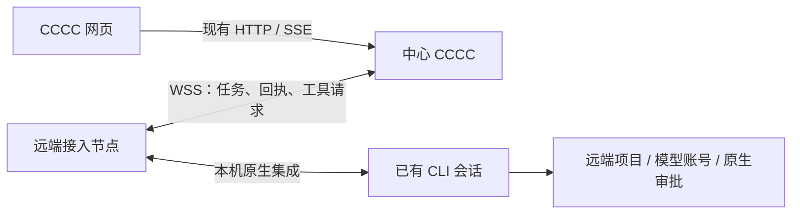

# 已有会话的远程接入设计

状态：局域网 iroh MVP 已实现，已通过隔离协议与页面验收；尚未部署到当前在线服务。
目标是让另一台机器上已经运行的原生 CLI 会话加入中心 CCCC 的工作组。第 1–9 节保留初始 HTTPS/WSS 方案与完整能力设计；本次选用的 iroh 局域网实现及其边界见第 11 节和[操作说明](../guide/local-sessions.md#connect-sessions-from-another-computer-lan)。

## 1. 方案与现有边界

增加“远端接入节点”，由它主动连接中心的 HTTPS/WSS 地址。远端 CLI 会话继续在原机器运行，中心负责工作组、成员授权、协作记录和投递调度。



远端只需主动访问中心地址，不需要开放自己的入站端口。中心地址本身必须可达；已有 VPN、HTTPS 反向代理或远程访问入口可提供这条网络路径。节点连接不能修复失效的隧道或不可达的中心地址。

| 当前能力     | 已有职责                                          | 本方案的关系               |
| ------------ | ------------------------------------------------- | -------------------------- |
| 本机会话接入 | 同机、同 OS 用户、同 `CCCC_HOME` 内发现和接入会话 | 保持原有路径               |
| Web 远程访问 | 在浏览器管理某台机器上的 CCCC                     | 可复用其 HTTPS 入口        |
| CCCC Connect | 连接两个工作组，交换消息和文件                    | 保留现有协议与授权         |
| 远端会话接入 | 让远端原生会话作为当前组的成员协作                | 新增独立节点通道与成员绑定 |

当前源码的依据：

- [原生会话说明](../guide/local-sessions.md)：原应用拥有进程、账号、上下文和审批；接入 CCCC 不导入其历史。
- [NativeHost](../../crates/cccc-core/src/local_sessions.rs)：PID、启动时间、boot/平台命名空间是本机所有权信息。
- [本地接入操作](../../crates/cccc-daemon/src/ops/local_sessions/mod.rs)与[接收租约](../../crates/cccc-daemon/src/ops/local_sessions/store.rs)：接收者、来源版本和租约受校验。
- [原生 MCP](../../crates/cccc-mcp/src/native_session.rs)：调用者提供的身份绑定会被移除，再由受信来源建立绑定。
- [本地 Web 入口](../../crates/cccc-web/src/routes/local_sessions.rs)：只给实例管理员提供目录与接入操作。
- [Connect 的边界](../guide/connect.md#direct-connections-without-an-account)：不开放远端工作区、终端、完整历史或任意工具。

因此不能只给现有本机接口加一个远程 URL，也不能把远端 PID 当成本机进程验证。

## 2. 用户流程

保留现有“接入会话”入口，增加“本机 / 远程设备”切换。

1. **远端连接中心。** 在会话所在机器以相同 OS 用户运行接入节点，加载本机已启用的原生集成。
2. **中心确认设备。** 远端显示短期设备码和中心域名，管理员在中心“接入会话 → 远程设备”中核对并批准。节点获得仅属于自身的连接凭据。
3. **选择可接入会话。** 远端用户控制哪些运行时/来源可被发现；中心只展示该范围内的会话，按设备分组，明确显示可接收、不可接收和离线状态。
4. **加入工作组。** 管理员选择会话与目标组，确认成员角色后接入。沿用当前成员上限、重复接入、对话归属和角色校验。没有额外的“远程工作组”类型。

设备配对与成员准入不变成逐条消息的二次审批。之后正常收发与重连自动进行，原生运行时自身的工具审批仍按原规则执行。

拟议命令，当前版本不可执行：

```sh
cccc sessions node connect --server https://cccc.example.com
```

设备码的交互参考 [RFC 8628](https://www.rfc-editor.org/rfc/rfc8628.html)：终端保管不可展示的设备凭证，网页处理管理员授权，短期用户码用于核对设备。借用交互模式，不要求先建设完整的账号平台。设备授权和工作组邀请使用独立凭据与授权记录。

界面初始只显示设备名称、运行时、会话标题、接收状态和“接入工作组”。网络诊断与技术标识收在详情里。设备在线不等于原生会话能接收；不能接收的来源需要回到原应用加载集成或恢复会话。

“移出工作组”撤销这条成员关系；“断开设备”撤销该设备的远程授权。两者都不默认退出原生 CLI，也不承诺取消已经开始的模型任务。

## 3. 两端职责

### 中心 CCCC

- Daemon 持有远端来源目录、设备/成员授权、投递状态；工作组、任务与账本继续使用现有权威存储。
- Web 层处理设备授权入口、节点鉴权与 WSS 通道，业务操作仍委托给 Daemon。
- 网页展示可接入的远端来源，不尝试读取远端进程或目录。

### 远端接入节点

- 复用远端本机 Daemon 与原生运行时适配器，不要求远端开启 Web 页面。
- 在远端验证进程身份、会话版本与接收能力；只上报授权范围内的元信息。
- 接收中心任务，交给同一原生会话；回传真实接收结果和协作事件。
- 把该来源在原生 MCP 中发起的 CCCC 协作操作路由到授权的中心工作组。

每台机器保留自己的 `CCCC_HOME`。中心与远端不共享 PID 命名空间、接收租约或本机身份文件。由 CCCC 管理的 Actor 继续使用原身份，不因安装了原生集成而重复注册为外部来源。

## 4. 来源、成员与调用身份

第一版复用 Actor 的外部来源引用语义，增加可识别的远端来源命名空间，例如 `remote:<node>:<opaque-source>`。它是引用，不是授权凭证。业务层通过一个来源解析入口返回 `local_native` 或 `remote_native`，避免各模块自行判断字符串。

远端记录至少绑定：

| 标识                                     | 用途                             |
| ---------------------------------------- | -------------------------------- |
| `hub_instance_id / node_id`              | 中心与设备命名空间               |
| `source_id / session_revision`           | 原生会话身份及版本               |
| `group_id / actor_id / actor_generation` | 当前工作组中的成员身份           |
| `grant_id / grant_revision`              | 当前授权及撤销边界               |
| `channel_epoch`                          | 本次网络连接，隔离旧连接的迟到帧 |

网络重连只改变通道代次，不能自动换原生会话。来源版本变化需通过明确的恢复/切换校验；不能按相同标题或复用的 PID 继承旧成员授权。

远端成员离线后仍保持远端所有权。来源查不到、网络中断或权限撤销，都不能退回本机 Codex/Claude 启动路径。

新后端需验证旧版降级时的安全行为：远端引用必须继续被视为外部来源，最多不可接收，不能被当成托管本机进程启动。未用旧发行二进制验证之前，不声明降级兼容已经成立。

### 双向工具路由

任务进入原生会话后，该会话的 `cccc_message_reply`、历史读取、任务和上下文工具也必须回到中心。仅把任务文本送过去，不算完成接入。

- 节点根据会话及成员授权建立路由；中心重新检查设备、来源版本、成员代次、角色与操作权限。
- 客户端不能通过 JSON 参数自报 `actor_id` 或内部 native binding 来取得身份。Web 网关注入的身份仍须由 Daemon 验证。
- 首版每个节点连接一个中心；原有本机成员关系保持。路由标识与现有本机接收租约的 `connection_id` 分开命名。
- 本机组与远端组发生标识歧义时，要求明确的中心/成员路由引用，不能按“当前组”或第一个匹配项猜测。路由引用由 MCP 层消费，不混入普通消息参数。
- 嵌套 code-mode、文件及批量操作同样需要传递完整身份；未打通的能力不在远端工具目录中宣称支持。
- 原生运行时的工具审批继续在原机器生效，接入节点不代用户接受审批。

## 5. 文件与执行位置

当前本地会话的原生工作目录与 CCCC 工具使用的 Group/Actor scope 本来就可能不同。跨机器必须明确执行位置：

| 操作                                     | 执行位置与规则                                  |
| ---------------------------------------- | ----------------------------------------------- |
| 原生 CLI 的 shell、读写代码、模型调用    | 远端原应用；保留其账号、工作目录和审批          |
| CCCC 消息、任务、上下文、协作历史        | 中心工作组；受成员权限约束                      |
| 读取收到的协作附件                       | 中心按引用和授权返回内容                        |
| 发送远端文件                             | 远端显式校验并读取，再用受限 HTTPS 附件通道上传 |
| 浏览远端整个目录、远程 PTY、任意远程命令 | 第一版不随接入开放                              |

中心的 `/Users/...` 路径不能直接当成远端 Linux/Windows 路径执行；远端路径也不能直接加入中心的本地 scopes。第一版保留远端项目标签与来源，不自动同步仓库、不按 Git origin 合并物理工作区。

第一版禁止把远端会话的工作区/命令请求默默转为中心文件读取或命令执行。尚无位置明确且授权完整的适配器时，该类 CCCC 工具需返回明确不支持，原生 CLI 自带的本地工具继续可用。

## 6. 传输与恢复

使用现有 Web 服务上的独立 WSS 端点，复用 [WebSocket](https://www.rfc-editor.org/rfc/rfc6455.html) 双向传输。远端主动建立连接；大附件走 HTTPS。第一版不替换现有 Direct/会员连接协议，也不引入新的 P2P 网络层。

通道只承载明确的帧类型：能力协商、来源快照/增量、投递、投递结果、受限工具调用/结果、授权更新。所有帧必须能绑定到具体来源和成员；不是通用 HTTP → Daemon IPC 代理。

### 状态分开记录

| 对象     | 概念状态                                      |
| -------- | --------------------------------------------- |
| 设备授权 | 待批准、已批准、已撤销、接入码过期            |
| 网络连接 | 连接中、在线、重连中、离线                    |
| 原生来源 | 可接收、接收通道未就绪、原应用已退出/会话结束 |
| 成员关系 | 已加入、暂停接入、已移出                      |
| 投递     | 排队、交付中、原生已接收、未提交、结果待确认  |

这些维度不能压成一个 `connected` 布尔值。已用接入码的过期不撤销已批准设备；设备在线不提升原生来源的接收状态；接收任务也不代表模型已经完成。

### 消息与回执

1. 中心按当前来源/成员版本创建稳定的投递 ID，并持久化待交付记录。
2. 节点持久化必要的投递/去重信息后确认网络收件，这个确认不写成原生 `accepted`。
3. 节点重新检查本机来源与授权，通过既有适配器交给原生会话；由原生接收事实产生最终回执。
4. 网络断线可重传同一投递 ID；节点返回已知结果，不能再次发起同一原生提交。
5. 一旦可能跨过原生提交边界、但结果不明，就记录“结果待确认”；支持查询的运行时可核实，其余留待人工确认，不自动重做。

不承诺跨网络和外部运行时的绝对 exactly-once；保证不把“未知”当“未提交”自动重放。模型回复、Mail 已读和任务完成沿用现有各自语义。

离线等待与原生 handoff 窗口分开。只有节点实际开始原生交付时才进入本机接收窗口，不把网络排队时间耗成原生提交超时。

重连使用心跳、退避与抖动，队列有界。旧通道、旧成员或旧来源的回执失效；中心恢复后对账未完成投递。等待网络期间不得长期持有全局启动/工作组锁，不能拖住其他本机成员。

## 7. 授权边界

- 节点凭据仅授权该节点；成员绑定再限制目标组和角色，不下发 Web 管理员 Token。
- 节点授权、会话发现范围和加入工作组是不同的授权对象。节点不能冒充另一台机器或未暴露的来源。
- 在服务器上使用独立的节点鉴权与限流入口；普通浏览器参数不能变成节点身份，本机 receiver 接口继续保持本机边界。
- HTTPS/WSS 校验目标中心与证书；凭据不经未知重定向转发，不写入 URL、shell 历史或日志。
- 凭据优先使用系统安全存储；无此能力的无头部署必须有明确的私有凭据存储方案、最小 OS 访问权限和轮换/撤销机制。
- 撤销后阻止新投递和协作工具调用，并在真正提交前再次校验；已经由原生运行时接收的工作可能继续，界面应准确说明。
- 中心不收集远端会话的模型 API Key、原生登录凭据或完整会话历史。节点属于其暴露来源的信任边界，远端机器失陷不能扩展到其他节点或未授权组。

## 8. 最小实现拆分

沿用现有 Rust crates；不为这一项拆成新的微服务。

| 位置                         | 新增职责                                                            |
| ---------------------------- | ------------------------------------------------------------------- |
| `cccc-contracts`             | 节点/远端来源引用、能力与消息帧，和本机租约区别命名                 |
| `cccc-core`                  | 节点身份、授权、远端来源目录和私有持久化模型                        |
| `cccc-daemon`                | 节点 client、中心成员绑定、投递对账和协作调用授权；复用来源解析入口 |
| `cccc-web`                   | 设备批准 HTTP 入口和 WSS 网关；保持薄路由                           |
| `cccc-mcp`                   | 本机/远端成员路由及嵌套调用身份传递                                 |
| `cccc-cli`                   | `sessions node` 管理入口；只解析与委托                              |
| `web/features/localSessions` | 远程设备和来源选择；复用当前目标组与成员角色流程                    |

接口名称待实施确定，职责至少包括：开始/确认设备接入、列出/撤销设备、打开节点通道、列出授权来源、加入/移出成员。不要把任意 Daemon op 暴露成远程 endpoint。

复用现有协作账本与投递状态，不做第二套“远程聊天记录”。新增持久化仅覆盖节点授权、来源目录、成员来源绑定和有界传输对账。

## 9. 交付顺序与验收

**第一步：打通完整协作闭环。** 先验证 Codex 与 Claude 的远端来源，设备接入 → 来源发现 → 加入现有组 → 收到任务 → 原会话回复/调用协作工具 → 中心回执。身份、撤销和断线去重从第一步就必须具备。

**第二步：补齐使用面。** 接入界面、受限附件传输、诊断和 Pi/OpenCode 的运行时验收；未通过的远端能力不显示为可用，本机已有支持不受影响。

最低验收清单：

- 当前本机来源、托管 Actor、Direct 与会员连接回归通过，旧字段与接入路径不被改写。
- 远端已有会话的账号、项目目录、审批与原生上下文保持；任务进入原会话，真实回复回到同一中心成员。
- 两台机器上相同会话/PID/目录名不能串线；同机器多会话不互相抢接收通道。
- 来源版本变化、旧回执、取消、中心/节点重启及撤销都有可解释结果。
- 在原生提交前断线可以恢复；跨过提交边界结果不明时不重复执行。
- 原生收件、工具执行、用户已读与回复完成不相互代替。
- 协作工具含嵌套调用统一鉴权；伪造节点、成员绑定或跨组请求被拒绝。
- 中心/远端的文件和执行位置不会混淆；附件权限与大小沿用现有约束。
- 新旧版本先协商 `remote_sessions` 能力；不支持时明确提示，不能静默换成本机会话或工作组连接。
- 网页验收覆盖设备授权、离线/恢复、撤销、桌面与手机。自动回归以协议、授权和交付边界为主，不新增启动 Chrome 的 CI 测试。

以上是完整方案的验收目标。当前 MVP 的实际范围与验证边界见第 11 节；WSS、公共中继、跨机附件及 Pi/OpenCode 不在本次实现内。

## 10. iroh 作为底层的可行性

根据后续讨论，本次选用 iroh 作为新远端会话通道的网络层。前文第 6 节是初始 WSS 基线；当前实现以 iroh 直连替代连接方式，保留来源身份、成员授权、投递与恢复边界。WSS 后备暂未实现。

```text
远端已有会话 ⇄ 远端接入节点 ⇄ iroh（直连 / Relay）⇄ 中心 CCCC
```

[iroh 官方说明](https://docs.iroh.computer/what-is-iroh)提供按公钥连接、QUIC 加密、NAT 穿透和中继路径，适合两端都是原生 Rust 程序的节点通道。接入时需明确：

- **网络身份与业务权限分开。** 持久化节点的密钥身份；把已验证的 Endpoint ID 绑定到 CCCC 设备授权。知道公钥或能建立连接，不代表可以列出会话、加入工作组或执行工具。
- **配对入口可以变化。** iroh 的端点地址票据可传递中心公钥及连接提示，设备准入仍由中心管理员批准。若希望中心不暴露公网 HTTP，设备码申请与批准结果也要通过受限的 iroh 引导协议传递，不能继续假设远端必能调用中心 HTTPS 接入接口。
- **浏览器入口保持。** 现有网页继续使用 HTTP/SSE 等入口；iroh 只用于新节点通道。本机 IPC、Direct 和会员连接不迁移。
- **采用现有协作语义。** 来源代次、撤销、去重、提交边界与未知结果策略都保留。iroh 的网络可靠性不等于原生会话已经接收任务。
- **文件分期适配。** 远端附件如果也要在没有公网 HTTP 的情况下工作，需在授权的 iroh 流上复用现有附件存储与校验语义。不能只替换控制通道，却继续隐含依赖不可达的 HTTPS 附件端点。
- **中继需要部署选择。** 官方公共中继有限额；生产使用要评估目标网络与可用的自建/托管中继，直连和中继都不可达时仍会失败。
- **第一版只接核心传输。** 不需要同步引入 gossip、docs/CRDT 或另一套协作账本。先验证 iroh 直连、中继与重连路径，再根据实际网络结果决定是否需要独立的 WSS 后备。

工具链前置升级已完成：项目最低 Rust 为 `1.91`，工程工具链固定 `1.91.0`。Apple Silicon 上的工作区构建、严格 Clippy、格式检查和原 CI 测试集合已通过；Linux、Windows 和 Intel Mac 仍需原 CI 矩阵验证。独立依赖解析也已确认已发布的 iroh `1.4.1` 声明最低 Rust `1.91`；iroh 与当前项目的加密后端、平台构建及两端线协议兼容，仍需在接入实现中验证。

本次仅将 iroh 加入新节点通道，本机 IPC、Direct、会员连接和网页 HTTP/SSE 保持各自现有协议。

## 11. 已实现的设备接入（直连与公网中继）

```text
原生 CLI ⇄ 本机 MCP / 原生收件适配器 ⇄ 前台节点桥接
                                          ⇅ iroh QUIC（直连 / 穿透入口后的原生中继）
                               中心网关 ⇄ 原工作组 / 账本 / 投递队列
```

- Rust 工具链固定 `1.91.0`，新网关使用 `iroh 1.4.1` 的 Minimal 配置与 AWS-LC；不连接默认公共 Relay、不做全网地址发布或广播发现。启用公网 Web 地址时，仅使用本实例穿透入口后的原生 Relay；保持同一协作账本。
- 管理员在“会话总览 → 添加设备”生成十分钟、一次性设备配对票据。它独立于工作组邀请；首次配对由票据授权，后续重连用持久化节点密钥。设备配对不直接获得组成员资格。网关保存已分配的 UDP 端口，普通 Web 重启时恢复已配对网关；节点沿用原密钥与成员绑定重连。
- 远端运行 `cccc sessions node connect --ticket-stdin --name laptop`。票据走 stdin，避免写入进程参数和 shell 历史。桥接进程保持前台，Ctrl-C 只断开桥接。节点仅导出该用户、该 `CCCC_HOME` 已登记的 Codex/Claude 来源，不转发其他远端来源。
- 中心仍由管理员从现有会话列表选择来源并加入组。来源使用节点公钥、授权代次与原生来源摘要组成命名空间；远端 PID 不作为中心机器上的进程验证，远端 cwd 不登记为中心物理工作区。
- 中心复用现有接收租约、逐条投递、账本 claim/accepted/ambiguous 处理；节点在原生提交前持久化交接屏障。未知结果和重用同一交接 ID 的不同负载均不自动重放。活跃账本与完成回执的保留策略见下文。
- Codex 使用原生 queue/steer，Claude 使用原有 Monitor。模型调用先在来源机器验证实际原生来源，再经私有 loopback broker 和加密通道返回中心；中心重查来源版本、组成员代次与角色，复用现有 MCP/Daemon 授权路径。
- 支持消息收发/回复/精确读取、Inbox、bootstrap/help、任务和上下文等明确列出的协作工具。文件、执行、能力安装及 code-mode 入口不通过该通道开放；原应用自己的工具继续在原机器执行。消息附件在原生交接前明确失败，暂不跨机传输。
- 设备撤销使新投递和工具调用失效；重新配对生成新授权与来源标识，旧组成员不会自动恢复。已跨过交接边界的原生工作可能继续执行，撤销不终止原应用。
- 管理接口：管理员专用 `/api/v1/session_nodes`、`/api/v1/session_nodes/invitations`、`/api/v1/session_nodes/{node_id}/revoke`。旧后台返回不支持，不静默切换到本机路径。桥接只在空闲 Home 启动 daemon，遇到旧 daemon 明确退出，不替换在线服务。

### 投递记录保留策略

节点的 `state/session_nodes/deliveries.json` 保留处理中及结果未知的交接屏障，上限为 8192 条；不因记录年龄、重连或容量压力删除这些记录。只有未决记录本身达到上限时，新交接才在原生提交前明确拒绝。`Accepted`、`Rejected` 和 `Unavailable` 是确定结果：先将负载摘要与原结果原子持久化到 `delivery_receipts/<身份摘要前缀>/<身份摘要>.json`，再从活跃账本移除。身份摘要涵盖中心、grant 和 handoff ID，文件不保存消息正文；未知结果不进入完成回执目录。

同一身份及负载的迟到重复请求仍返回原结果，不再次调用原生适配器；同 ID 异负载拒绝。完成回执不按 TTL/LRU 淘汰，处理中和未知记录也不自动过期。现有 handoff ID 为随机 UUID，没有可信的重放截止时间，删除旧回执会重新开放重复执行。因此有界的是活跃账本与每次回执读取，永久精确去重索引的磁盘占用仍随历史增长；磁盘写入失败时拒绝新提交，不能以丢弃去重凭据换取可用性。旧版活跃账本中的确定结果每次新请求最多迁出 128 条，保持原回执和冲突校验；回执落盘后、活跃记录移除前发生中断，可以由该回执恢复，不重放原生提交。活跃账本写成版本 2 的封装格式，使不认识完成回执的旧 daemon 在读取时明确失败，不能在同一 Home 上混用或直接回退旧 daemon。

自动验收使用独立的中心/节点 Home、真实 iroh 连接和原有 CLI/MCP/Monitor 进程。Codex queue 的可执行程序边界使用明确的离线夹具；这不代表调用过真实 Codex/Claude 模型，也不代表完成了两台物理机器或全部平台验收。页面用真实浏览器单独检查，不新增前端测试或 CI Chrome 用例。


公网路由使用版本 2 的票据，应用 ALPN/hello 仍为版本 1，旧直连票据与缓存可继续使用。票据内的中继引导凭据与端到端配对密钥分离；中继权限不能完成设备配对，也不能阻止持有真正配对密钥的直连设备配对。`/relay` 仅承载已签名设备身份的原生中继，`/ping` 和 `/generate_204` 提供必要探测；Exhibit 不开放这些端点。断开/关闭公网路由不撤销有效的 LAN 设备授权；设备撤销则关闭既有中继并拒绝重入。所有未知写入仍不自动重放。
